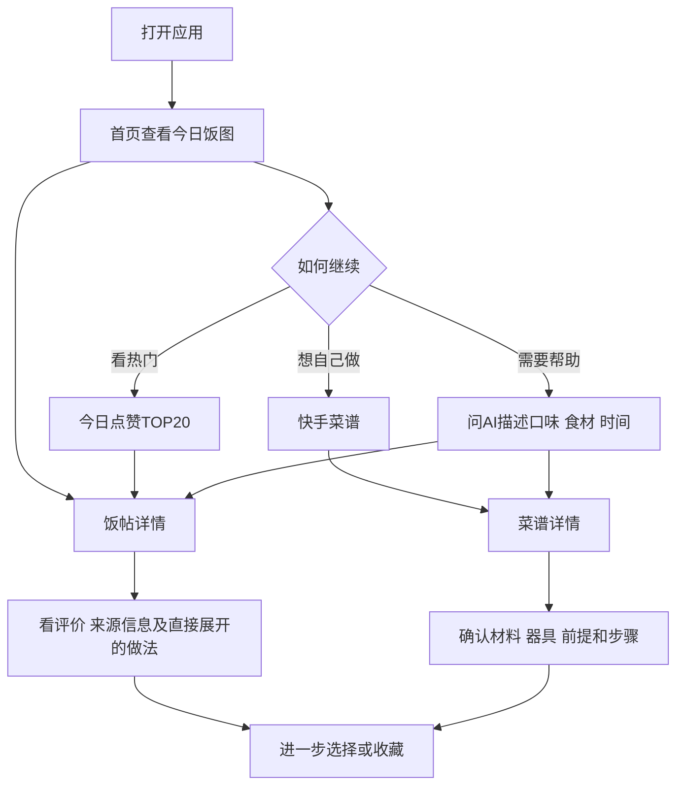
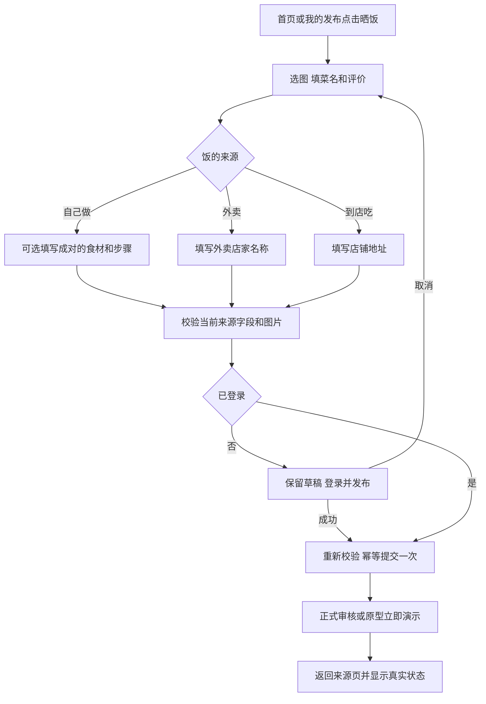
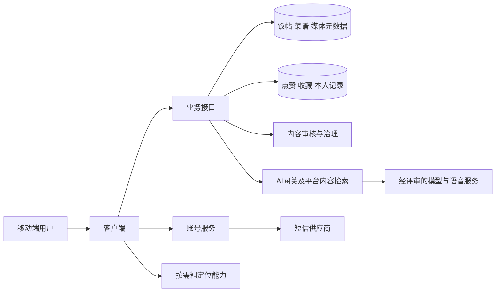
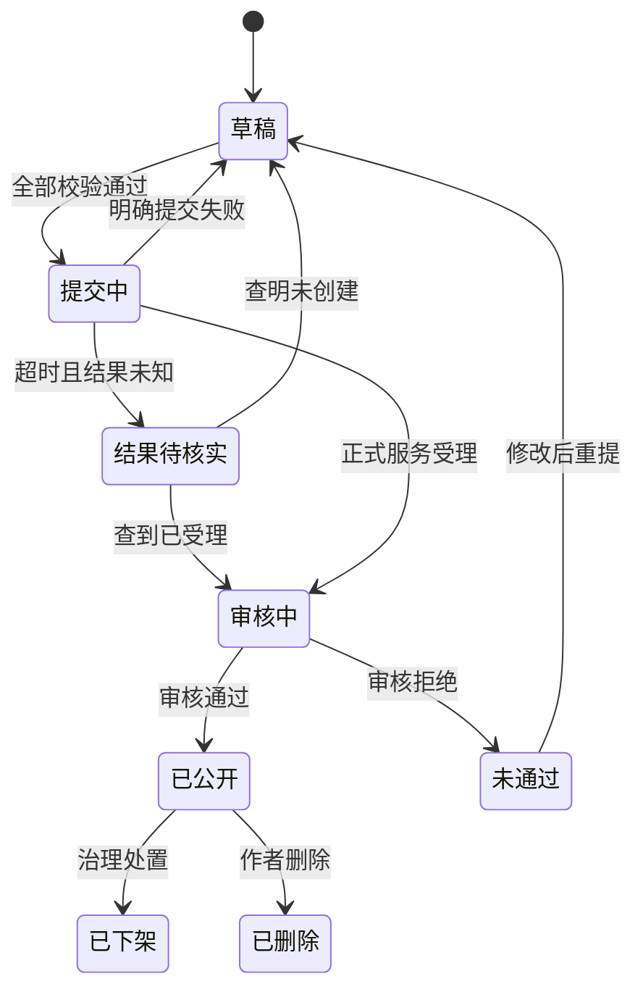

# 今天吃啥移动端产品需求文档

版本：V1.0.0 评审版  
日期：2026-10-30  
产品名称：“今天吃啥”为工作名称，正式名称与商标另行确认。  
适用范围：移动端消费者 App；以当前番茄橙红 UI 稿为视觉和交互基线。

| 版本 | 日期 | 修订角色 | 修订内容 |
|---|---|---|---|
| V1.0.0 | 2026-10-30 | 产品与设计协作 | 汇总已讨论功能，补充登录、统一收藏小图、工程要求及验收口径 |

本文件用于产品、设计、客户端、服务端、测试与运营共同评审首版范围。核心任务是帮助普通打工人在看到饭图后尽快决定想吃什么，或找到自己能简单做出的饭。本文定义目标行为与正式开发要求；可点击 UI 使用示例图片、内存数据及模拟登录和对话，不代表真实账号、短信、AI、语音、定位或外卖平台已经接通。

需求状态统一分为四类：“已确认”表示已确定的产品方向和交互；“原型演示”表示当前 UI 可以验证的范围；“正式开发新增”表示真实产品必须补齐但原型尚无的服务与运营能力；“建议待确认”表示本文给出默认方案，评审后才能作为最终基线。未标为已确认的参数，不应被当作现成业务结论或供应商承诺。

## 一 概述

### 1.1 背景与产品定位

普通打工人的吃饭决策常同时受到时间、预算、食材、做饭器具和精力限制。现有处理方式包括反复浏览外卖列表、询问同事、重复点熟悉的餐食，以及在大量步骤复杂的菜谱里筛选。这里描述的是产品假设与使用场景，尚无访谈样本、市场规模或实际转化率可作为验证结论。

产品把“今天别人吃了什么”的真实图文作为发现入口，把“我能否简单做出来”的菜谱作为执行入口，AI 帮助缩小候选范围和解释已有内容。社区发布与收藏承接长期内容积累；浏览不强迫登录，发生个人写入时再建立账号会话。

**核心用户任务：打开应用后，尽快选出一份想吃的饭，或一份适合自己条件的简单菜谱。** 观看、点赞、收藏、打开菜谱都是意图信号，不等于实际购买、实际吃过或已经决定，数据分析不得混为一谈。热榜表示“今日晒饭中获得较多有效点赞的内容”，不能声称代表所有人的真实饮食偏好。

### 1.2 产品目标与验证方法

| 目标 | 指标与口径 | 默认建议与验证 |
|---|---|---|
| 减少选饭成本 | 从首次有效饭图曝光到主动选择进一步查看/收藏的时长；另做任务访谈确认是否真的作出选择 | 建议先邀请10名目标用户做可用性测试，至少7名在60秒内选出愿意尝试的一份饭或菜谱；作为立项验证目标，非已达到数据 |
| 知道自己能否做 | 用户能指出总耗时、器具和主要食材，理解已有熟米饭等前提 | 建议10人测试中至少9人能正确复述所选菜谱的关键限制；菜谱必须试做核验 |
| 保持内容可信 | 作者做法、平台参考与AI参考的归属可辨认 | 作者/平台/AI来源不能混淆；未知食材不凭图片补为事实；属于验收硬条件 |
| 支持社区积累 | 发布成功率、有效公开饭帖数、有效收藏及回访 | 内测先建立2周基线，再确定增长目标；不虚构已有留存、DAU或转化率 |
| 降低登录打断 | 登录完成率、取消后草稿保留率、原动作成功续办率 | 取消不得丢草稿；一个意图至多执行一次；按登录入口分组测量 |

### 1.3 目标用户与典型任务

| 用户群 | 使用情境 | 要解决的问题 | 典型路径 |
|---|---|---|---|
| 工作日外卖用户 | 午休或下班前 | 不知道想吃什么，想先看饭图和评价 | 首页/附近/热榜→饭帖→店家信息或收藏 |
| 下班做饭用户 | 时间少，有常见食材 | 找少步骤、少切配的家常饭 | 菜谱分类→食材/时间→做法 |
| 做饭条件有限用户 | 器具有限、厨房小 | 明确现有器具和时间能否完成 | 问AI输入限制→核实匹配菜谱→做法 |
| 日常记录用户 | 已经吃完或正在吃饭 | 留下饭图、感受与可分享做法 | 晒饭→选择来源→登录→发布→我的发布 |

### 1.4 名词与数据语义

| 名词 | 本文含义 |
|---|---|
| 饭帖 | 用户晒出的某一顿饭：图片、菜名、评价和来源；不等于完整菜谱 |
| 菜谱 | 一道菜的用料、用量、步骤、总耗时、器具与前置条件 |
| 一餐菜单 | 多道菜或主食/配菜的组合建议，由AI解释；不会直接等同于独立菜谱 |
| 来源 | 自己做 self、外卖 takeaway、到店吃 dine_in；后台使用稳定 code |
| 有效赞 | 经账号唯一性与风控处理后，仍有效的点赞关系；取消或无效赞不计入 |
| 今日 | [建议 E-06] 按 Asia/Shanghai 的自然日，以服务端权威时间为准 |
| 作者菜谱 | 作者明确随饭帖提供的完整用料与步骤 |
| 平台参考 | 明确关联或严格同名匹配的菜谱，不代表饭帖作者真实使用的做法 |
| AI参考 | 模型生成的建议，须有来源标识，不冒充实测菜谱或真实商家信息 |
| 收藏 | 当前账号对饭帖或菜谱建立的关系；类型和ID共同标识目标 |

### 1.5 角色与权限

| 角色 | 可访问内容 | 可执行操作 | 数据边界 |
|---|---|---|---|
| 游客 | 首页、热榜、菜谱及公开详情 | 浏览、切图、受配额约束的问AI、先填写发布草稿 | 不读取个人收藏和发布记录；点赞/收藏/最终发布先登录 |
| 已登录用户 | 公开内容与本人记录 | 点赞、收藏、发布、取消本人互动，查看本人状态 | 正式版以服务端accountId鉴权，不能用客户端传入的任意用户ID越权 |
| 内容编辑与审核运营 | 按岗位授权的内容工作台 | 维护试做菜谱、处理举报与审核、下架 | 最小授权、记录审计；不是新增消费者一级Tab |
| 系统服务 | 业务必需的数据 | 账号验证、媒体处理、排序、内容检索、模型转发 | 密钥和权限校验置于可信服务端 |

### 1.6 阅读对象与评审责任

产品确认范围、目标与待确认项；设计确认视觉、交互状态和可读性；研发确认接口、权限、生命周期和容量；测试把需求编号映射到用例与证据；运营确认菜谱来源、试做、审核与反馈渠道。技术栈和供应商未定，不以此PRD替代接口联调文档、数据迁移方案或上线审批。

## 二 产品描述

### 2.1 首版范围及边界

首版范围为四个Tab，以及饭帖详情、菜谱详情、发布、登录与上下文AI。附近属于饭帖筛选，不承诺展示某个外卖平台的全部商家或全部可售餐品。首版不增加“发现”Tab、购物车、支付、配送、私信、关注流、评论系统、复杂搜索、独立营养计算器或后台定时通知。

最早提出的“随机附近的饭”和美团餐品接入保留为后续探索，不在当前已确认的四Tab和UI范围中。若重新纳入，必须单独确定候选来源、授权、营业/配送范围、去重与失败方案，不能把当前附近饭帖随机理解为可实时下单的外卖商品。

### 2.2 整体流程

#### 2.2.1 看图到选择

#### 2.2.2 发布和账号子流程

#### 2.2.3 正式系统数据流

客户端不直接携带模型、短信或第三方商家接口的生产密钥。数据流图仅表达职责，不锁定某种框架、数据库或云服务。

#### 2.2.4 发布状态

审核方案为 [建议 E-03]。原型使用立即写入内存的演示，不显示为真实审核成功；正式接口未知结果时不得不断新建同一帖子。

### 2.3 全局规则与视觉基线

| 项目 | 首版规则 |
|---|---|
| 一级导航 | 首页、热榜、菜谱、我的；二级页显式返回，保留来源与可恢复位置 |
| 主题 | 番茄橙红 #CC462C、白底、正文 #242424、辅助 #666666、浅灰 #F6F7F8、浅桃 #FFF0EB；深色模式使用对应可读配色 |
| 强调层级 | 主操作实色、分类轻底、Tab与点赞使用主题色；不让每个标签都成为主操作 |
| 尺寸 | 390逻辑像素为设计参考，支持320窄屏；左右16，窄屏12；卡片圆角12；正文14至16；主要可点区域至少约44×44 |
| 收藏 | 两种目标一律88×88方形小图横排，含类型、标题、摘要和取消收藏入口；与首页双列大图分开 |
| 图片 | 保持食物自然颜色；封面第一张；多图角落页码；图片不固定加统一暖色滤镜 |
| 列表加载 | [建议] 首页/菜谱/个人列表20条游标分页，触底加载和下拉刷新；热榜最多20条整体返回，无PC式分页器 |
| 排序 | 首页正式版建议首次公开时间倒序；我的发布创建时间倒序；收藏savedAt倒序；热榜见E-06 |
| 数据状态 | 首载骨架、已有缓存、追加加载、空结果、失败可重试、内容失效分别处理；不把接口失败显示成0条记录 |
| 返回及草稿 | 切换来源保留各自输入；取消登录保留草稿；退出账号清理个人缓存和本机草稿，正式版有未提交内容时先说明并允许取消 |
| 安全与文本 | 输入按纯文本呈现，不执行HTML和任意模型链接；错误给出可恢复方式，短提示不替代关键失败说明 |

公开列表可为空。冷启动不能用虚构用户身份、虚构点赞或AI图片冒充真实社区动态。运营示例应明确标识，正式平台菜谱采用合法来源并完成审核试做。

### 2.4 版本规划与开发依赖

| 阶段 | 范围 | 完成条件 | 时间 |
|---|---|---|---|
| UI评审 | 当前四Tab、登录模拟、统一收藏、来源表单、轮播与AI示例 | 视觉、流程和需求范围确认，记录未实现能力 | 当前交付；不等于可上线 |
| V1内测 | 真实账号、媒体投稿、菜谱、点赞收藏、榜单、AI文字、治理最小闭环 | 适用P0通过，真实服务联调、数据隔离与运营可用 | 团队与预算确认后排期 |
| V1完整目标 | 按需附近、真实语音输入及完整异常恢复 | 位置/录音授权、降级、配额与隐私方案通过；若延期需明确调整范围 | 技术依赖确认后排期 |
| 后续探索 | 随机选饭、经授权外卖数据、更多器具和食材策略 | 先验证用户价值与数据授权，再另行立项 | 无承诺日期 |

### 2.5 功能框架与优先级

| 模块 | 页面或能力 | 优先级 | 本版边界 |
|---|---|---|---|
| 首页 | 当天饭图、全部/附近、晒饭入口 | 核心P0；附近集成P1 | 附近只针对本平台有授权位置的内容 |
| 热榜 | 每日有效点赞TOP20、四档角标、可靠食材标签 | P0 | 无菜谱榜；少于20不补足 |
| 菜谱 | 推荐、15分钟、一锅、少食材及详情 | P0 | 快手家常为主，时间与前提需核实 |
| 我的 | 登录态、我的发布、统一小图收藏、退出 | P0 | 无复杂社交资料、关注流或私信 |
| 发布 | 多图、菜名、评价、三来源分支、作者可选菜谱 | P0 | 外卖店名和到店地址由作者填写，不伪装接口回填 |
| 问AI | 三处入口、上下文、文字条件选餐/菜谱与一餐搭配 | P0 | 只推荐可验证内容，生成内容明确来源 |
| 语音 | 录音权限、识别后编辑再发送、失败回退文字 | P1 | 纳入V1完整目标；当前只有示例文字 |
| 治理与账号安全 | 真实鉴权、审核、举报处理、下架、删除与基础注销流程 | 上线P0依赖 | 可复用既有管理服务，不为消费者增加Tab |

### 2.6 当前原型与正式实现的差异

当前 UI 可验证布局、单演示账号登录拦截、收藏小图、内存发布、图片横滑和轮播暂停、提示一次、示例对话。它不请求真实网络服务。模拟登录不会验证手机归属或注册账号；手机号、验证码和登录态不持久化。既有非敏感收藏、点赞和界面偏好可能恢复，但新发布与照片只在本次运行中存在。

正式版必须实现服务端账号鉴权、跨设备个人数据、实际图片处理和内容存储、有效赞规则、日榜、语音、位置和模型能力，以及所有相关失败与治理路径。正式用例不能使用原型代替验收。具体功能规则见第三章，工程与接口见第四章，测试证据和通过条件见第五章。

