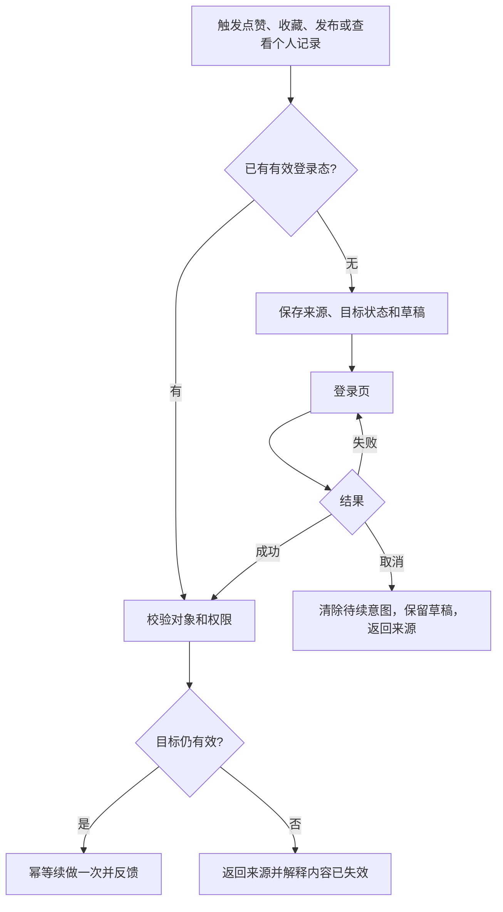

## 三、功能需求（怎么做）

本章以已确认的四个移动端 Tab 和已迭代的 UI 稿为基线。标记为“已确认”的内容来自本次讨论；“建议待确认”是为使开发、测试可执行而提出的默认方案；“原型演示”只说明当前可点击稿的表现；“正式开发新增”必须在真实客户端、服务端及第三方能力中实现，不能据原型效果认定已完成。

### 3.1 导航、页面和全局操作

**描述与用户故事**：作为想尽快决定吃什么的用户，我希望打开应用就能看饭图，并随时进入热榜、简单菜谱或自己的记录，减少找入口的时间。

**前置条件**：应用可启动。公开浏览不以前置登录或授予定位权限为条件。**后置条件**：切换页面后有明确的当前位置；返回详情来源列表时保留筛选和浏览位置。

| 需求编号 | 元素/操作 | 默认与规则 | 反馈与边界 |
|---|---|---|---|
| REQ-NAV-01 | 底部主导航 | 固定顺序为“首页、热榜、菜谱、我的”，只设这四个一级 Tab | 图标和文字同时存在；当前 Tab 以主题色标识；重复点选不叠加路由 |
| REQ-NAV-02 | 二级页面 | 饭帖详情、菜谱详情、发布页、登录页为二级页面 | 有显式返回入口；从收藏或热榜进入详情，返回原来源，不一律回首页 |
| REQ-NAV-03 | 页面状态 | 每个 Tab 保留本次运行中的筛选状态与滚动位置 | 不把切换 Tab 当成重新初始化全部数据；主动下拉刷新可以更新数据 |
| REQ-NAV-04 | 公开与个人内容 | 游客可浏览首页、热榜、菜谱及详情，可使用问 AI；点赞、收藏和最终发布需要登录 | 点击受限操作后按 3.2 节登录并续做；不在应用启动时强制登录 |
| REQ-NAV-05 | 操作反馈 | 短成功提示不遮挡主要内容；错误贴近对应控件 | 网络失败不清空已输入内容；成功与失败使用具体对象，如“已收藏这份饭” |

**业务流程**：启动进入首页 → 查看饭图或切换其他 Tab → 打开内容详情 → 返回来源列表；需要账号身份的操作进入登录子流程，完成后回到原上下文。

**异常与分支**：目标内容已删除或下架时，详情显示“内容暂时无法查看”，保留返回入口；导航加载失败保留底栏和已缓存内容；登录失效不能清空正在编辑的草稿；恢复到不存在的历史内容 ID 时回到对应 Tab，并给出轻提示。

| 字段 | 类型 | 必填 | 说明 | 示例 |
|---|---|---|---|---|
| page_key | Enum | 是 | 当前页面，使用稳定 code | `home`、`post_detail` |
| source_page | Enum | 条件必填 | 二级页面的来源页面 | `favorites` |
| target_type / target_id | Enum / String | 条件必填 | 详情或待续操作指向的对象 | `post` / `p_1001` |
| filter_state | Object | 否 | 当前分类等可恢复状态 | `{category: "quick"}` |
| scroll_anchor | String / Number | 否 | 优先用内容锚点，辅以像素偏移 | `p_1001` |

### 3.2 登录、退出和登录后续做

**范围与状态**：增加“我的”未登录/已登录两种界面。手机号验证码登录为 **[假设 A-01，建议待确认]**；首版建议不引入密码、第三方账号绑定、多账号切换或复杂个人资料表单。

正式版建议采用“验证码验证通过后，已有账号登录、未注册号码创建账号”的登录注册合一流程，列入 A-01 一并确认；不新增第二套注册表单，不在短信发送前公开提示该号码是否已注册。原型没有真实的号码归属验证或账号创建能力。

**用户故事**：作为游客，我希望先看内容，收藏或发布时再登录，登录后继续刚才的操作，不用重新找那道菜或重填晒饭内容。

**前置条件**：手机号格式、验证码获取状态及协议勾选等校验通过；真实版本需短信与账号服务可用。**后置条件**：登录成功建立有效账号会话，返回来源页面并最多续做一次原操作；取消或失败保持游客态。

#### 3.2.1 登录界面、校验与行为

| 需求编号 | 元素 | 类型/默认 | 校验与行为 | 失败/成功反馈 |
|---|---|---|---|---|
| REQ-AUTH-01 | “我的”登录区 | 头像占位、登录说明、登录按钮 | 游客状态不展示为“已登录”，不伪造已获取的个人资料 | “登录后查看发布和收藏”；个人数量可以隐藏或用未登录占位，不能把未请求数据等同于 0 |
| REQ-AUTH-02 | 手机号 | 数字输入，默认空 | 原型：11 位且以 1 开头；正式运营国家/地区范围待确认，前后端规则一致 | 格式错误时焦点定位输入框，提示“请输入正确的手机号” |
| REQ-AUTH-03 | 获取验证码 | 按钮，默认可点击 | 手机号格式、协议勾选等前置校验通过后发起；请求中不可重复点击；成功后 60 秒重发冷却 | 失败不开始成功倒计时，保留手机号并可重试；倒计时由服务端实际发送结果驱动 |
| REQ-AUTH-04 | 验证码 | 6 位数字，默认空 | 必须先获取验证码；输入满 6 位仍需点击登录，不自动提交 | 缺失、错误、过期分开提示；错误后不清手机号 |
| REQ-AUTH-05 | 协议与隐私说明 | 未默认勾选的复选框、可访问的文本入口 | 用户主动勾选后才发起相应账号操作；正式版协议链接须可阅读 | 原型说明是演示协议；正式文本、版本与记录方式需上线前确认 |
| REQ-AUTH-06 | 登录主按钮 | 按钮 | 从“我的”进入显示“登录”；有待续操作时显示“登录并点赞/收藏/发布”等具体行为 | 校验通过后进入请求中状态；超时、错误不宣称成功 |
| REQ-AUTH-07 | 返回/取消 | 显式返回入口 | 关闭登录，清除该次待续操作；发布草稿保留 | 取消不会在之后从其他入口登录时误执行旧收藏或旧发布 |
| REQ-AUTH-08 | 登录成功 | 会话建立后执行 | 恢复来源页面、对象和筛选上下文；重新核验目标有效性与权限后只续做一次 | 有效对象完成原操作；已删除对象仅提示，不创建错误关系；不能重复加赞或重复发帖 |

正式短信挑战有效期、单号/设备/网络发送频率、错误尝试次数与封禁规则为 **[建议待确认]** 的服务端参数，不由客户端倒计时替代安全校验。验证码示例 `123456` 只能出现在原型或明确隔离的测试环境。

#### 3.2.2 登录后续做的约束

| 待续操作 | 登录前保留 | 登录成功后 | 取消/失败后 |
|---|---|---|---|
| 点赞或取消点赞 | 饭帖 ID、目标点赞状态、来源页面 | 按目标状态写入一次，再刷新计数和榜单 | 不修改计数，仍停留可浏览内容 |
| 收藏或取消收藏 | 对象类型、对象 ID、目标收藏状态 | 创建或取消一次关系，更新详情和“我的”列表 | 不产生收藏；来源内容仍可查看 |
| 最终发布 | 草稿全部字段、照片顺序、来源页面、提交意图 ID | 登录后重新校验草稿和上传状态，再进行一次提交 | 草稿仍在，未发生真实发布 |
| 查看个人记录 | “我的发布/我的收藏”子栏目 | 登录后进入对应栏目 | 返回未登录态，不显示其他人的个人数据 |

待续操作应保存目标状态和唯一操作标识，不能把网络重试写成反复切换的 `toggle`。用户取消登录时清除待续意图，草稿与待续意图分开保存。会话失效后重新认证同样遵守这些规则。

#### 3.2.3 原型与正式账号系统的边界

原型只模拟一个“演示饭友”账号：先点击获取验证码、等待/使用演示码 `123456`、勾选演示协议，再登录。它不发短信，不校验号码归属，不真实注册账号，不创建或持久化真实 Token。手机号、验证码和模拟登录态只在当前内存中存在，刷新后回到游客态。

原型退出登录时清空手机号、验证码、待续意图和当前发布草稿，隐藏个人收藏/发布视图。已有公共演示饭帖及非敏感演示收藏不删除；重新模拟登录仍能查看当前演示会话中保留的内容。该行为只适用于单演示账号，不能当作生产多账号隔离方案。

正式版必须按 `account_id` 隔离收藏、本人发布、草稿与会话；退出清理本机个人缓存和凭据，服务端个人内容保留并在本人重新登录后获取。退出不等同于删除账号或删除已发布内容。涉及账号注销的入口、二次验证、撤销期限及数据处置方案在上线前单独评审，不用“退出登录”冒充账号注销。

| 字段 | 类型 | 必填 | 说明 | 示例 |
|---|---|---|---|---|
| account_id | String | 正式登录成功后是 | 服务端账号唯一标识；不使用手机号当公开 ID | `u_1001` |
| phone_number | String | 登录请求时是 | 原型仅内存；正式版只发送至必要的账号服务 | `<11位测试号码>` |
| verification_challenge_id | String | 正式验证码校验时是 | 关联一次发送挑战，不能只比较客户端常量 | `challenge_xxx` |
| verification_code | String(6) | 是 | 仅本次校验请求使用；不进入埋点 | `123456`（仅演示） |
| agreement_accepted | Boolean | 是 | 默认 false；正式版需关联协议版本 | `true` |
| resend_available_at | Timestamp | 发送成功后是 | 重发可用时间；原型冷却 60 秒 | `发送成功时间+60秒` |
| pending_action | Object | 有待续操作时是 | 类型、对象、目标状态、来源、唯一意图 ID | `{type: "save", targetType: "recipe"}` |
| session_state | Enum | 是 | `guest`、`authenticated`、`expired` | `guest` |

**异常分支**：发送失败可重试；验证码错误保留其他输入；冷却期间重进页面保持剩余秒数；发送成功后修改手机号需重新取码，旧挑战不得用于新手机号；登录成功但待续操作失败只提示该动作失败，不能回滚为“登录失败”；登录成功回包晚于用户主动取消时，不再自动执行被取消的业务动作。

### 3.3 首页与附近饭图

**描述与用户故事**：作为打工人，我希望通过真实晒饭图片快速发现今天想吃的饭；有需要时可看看附近的人在吃什么。

**前置条件**：存在可公开展示的饭帖。附近模式另需可用的位置或用户选定区域。**后置条件**：用户可以进入饭帖详情、点赞或开始晒饭；拒绝定位仍能使用全部内容。

| 需求编号 | 元素/操作 | 已确认规则与建议默认 | 反馈/边界 |
|---|---|---|---|
| REQ-HOME-01 | 默认信息流 | 首页默认双列图片卡片，不以填写条件作为看图前置步骤 | 菜名、最多两行评价、作者、来源、点赞数清楚可见；图片保持原色 |
| REQ-HOME-02 | 卡片封面 | 取饭帖第一张图片；多图标出“n张” | 列表不自行轮播；真实原图比例不应拉伸，缩略图使用裁切 |
| REQ-HOME-03 | 全部/附近 | 默认“全部”；“附近”为可选入口 | 未授权时在点击附近后解释用途并请求；拒绝不循环弹权限申请 |
| REQ-HOME-04 | 内容范围 | 首页主信息流为当天公开发布的有效饭帖 | “当天”统一按服务端业务时区计算；原型使用预设 `today` 标志，不代表真实日期查询 |
| REQ-HOME-05 | 排序与翻页 | **[建议待确认]** 全部按首次公开发布时间倒序；同一时间按 ID 稳定排序，游标分页默认 20 条 | 翻页去重，不因插入新帖重复/漏掉已读项；顶部刷新获得新内容 |
| REQ-HOME-06 | 晒饭入口 | 首页页头保留“晒饭” | 游客可先填写草稿；最终提交时登录，不要求先回“我的” |
| REQ-HOME-07 | 跨日 | 正式版前台恢复或刷新时重新核对业务日期 | 首页与热榜切换到新的一天；旧饭帖仍可从历史记录和收藏查看 |

附近默认范围建议为 `NEAR_RADIUS_M=3000` 米，列为 **[建议待确认]**；它是内容发现范围，不是商家配送范围。原型只展示预设“附近”样例，不获取真实定位，也不保证展示真实附近饭帖。正式版仅把用户选择公开位置的内容纳入附近计算，不公开发布者的精确坐标；外卖店名或到店地址不能替代发布者是否同意公开位置的判断。

**业务流程**：打开首页 → 默认看全部饭图 → 可点附近并完成位置选择 → 查看列表 → 打开饭帖 → 返回原筛选与浏览位置。

| 异常/分支 | 处理要求 |
|---|---|
| 今天暂无内容 | 显示“今天还没有人晒饭”，提供“晒饭”和“看看菜谱”；不把历史帖子伪装成今天 |
| 附近为空 | 说明“附近暂时没有今天的晒饭”，提供回到全部；不把全国内容仍标为附近 |
| 定位拒绝、系统关闭或超时 | 保留全部列表；可重试或手动选定区域的正式方案待确认 |
| 首页请求失败 | 有缓存则保留并标明未更新；无缓存提供重试，不出现无限转圈 |
| 图片失败 | 固定尺寸占位与重试，不造成瀑布流跳动；评价和标题仍可读 |
| 内容被下架 | 刷新后剔除；进入已缓存详情时以服务端可见性为准 |

| 字段 | 类型 | 必填 | 说明 | 示例 |
|---|---|---|---|---|
| post_id | String | 是 | 饭帖标识 | `p_1001` |
| cover_image | ImageRef | 是 | 第一张图的缩略图及原图引用 | `image_01` |
| image_count | Integer | 是 | 1—9 | `3` |
| title / review | String | 是 | 列表摘要与详情共用同一来源数据 | `豆角焖面` |
| meal_source | Enum | 是 | `self` / `takeaway` / `dine_in` | `self` |
| published_at | Timestamp | 已公开时是 | 服务端首次公开时间 | `2026-10-29T10:00:00+08:00` |
| public_location | ApproxLocation | 否 | 经允许公开的近似位置，缺失不进入附近 | `网格/区域引用` |
| liked_by_me / like_count | Boolean / Integer | 是 | 本人状态与公开总量分开 | `false` / `18` |

### 3.4 今日热榜与食材标签

**描述与用户故事**：作为还没有想法的用户，我希望快速比较今天点赞较多的饭，借助主要食材判断自己是否想吃。

**前置条件**：存在当天公开且至少 1 个有效赞的饭帖。**后置条件**：展示最多 20 条，进入的仍是饭帖详情，榜单数量和顺序可以追溯。

| 需求编号 | 元素/规则 | 具体要求 |
|---|---|---|
| REQ-RANK-01 | 榜单对象 | 只有当天饭帖点赞榜，没有另一份每日菜谱榜；前端不凑满 20 条 |
| REQ-RANK-02 | 排序 | 有效点赞数降序；**[建议待确认]** 同赞按首次公开时间升序，再按 ID 升序，避免刷新时随机跳位 |
| REQ-RANK-03 | 排名角标 | 放在缩略图左上角；第 1 名橙红底、第 2 名银灰底、第 3 名浅铜底；第 4—20 名统一中性深灰底；数字位置、大小与形状统一 |
| REQ-RANK-04 | 列表布局 | 左侧小图及角标，右侧菜名、食材标签、作者/来源和点赞；不再单独占一列显示排名 |
| REQ-RANK-05 | 主食材标签 | 最多 3 个，不作为可点击筛选 Tab；只显示明确记录的短食材名，油、盐等通用调料不占主要标签 |
| REQ-RANK-06 | 来源可信度 | 作者完整菜谱优先；平台明确关联或严格同名匹配时，标签旁显示“参考食材”；没有可靠来源就不补标签，不能看图猜成实际用料 |
| REQ-RANK-07 | 点赞同步 | 本人点赞状态与详情、首页一致；取消赞同步扣减；排名刷新采用服务端结果，不在客户端伪造热门度 |

**热度口径**：热榜展示“当天公开饭帖的当前有效累计点赞数”，不是下单量、真实食用量，也不宣称代表所有人的真实购买意图。正式版赞关系需去重、鉴权及防刷；非法/撤回的点赞不进入有效计数。原型用样例基础赞数加本人演示状态展示页面联动。

**更新建议**：点赞按钮立即反馈本人的预期状态，失败回滚并提示；榜单在本次刷新或可靠事件通知后重排，避免用户正在触摸时目标行突然换位。刷新间隔、缓存时效由性能章节确定，属于建议参数。

| 异常/分支 | 处理要求 |
|---|---|
| 无有效点赞内容 | 显示今日热榜空态，提供返回首页；不加入 0 赞饭帖凑榜 |
| 数据少于 20 条 | 如实展示条数，不放假内容或无意义占位排名 |
| 入榜内容删除/审核撤回 | 服务端查询排除，缓存失效后移除，余项递补并重新编号 |
| 赞数回包落后 | 以版本号/服务端结果协调，不能让较旧响应覆盖较新操作 |
| 食材长文本或缺失 | 超长未归一化内容留在详情，不把整段做法塞成标签；缺失保持行内自然留白 |

| 字段 | 类型 | 必填 | 说明 | 示例 |
|---|---|---|---|---|
| business_date | Date | 是 | 榜单业务日 | `2026-10-29` |
| rank | Integer | 是 | 1—20，按当前结果连续编号 | `1` |
| effective_like_count | Integer | 是 | 当前有效赞数，非负 | `18` |
| main_ingredients | String[] | 否 | 最多 3 个主要食材标签 | `["豆角", "面条"]` |
| ingredient_origin | Enum | 有标签时是 | `author` / `platform_reference` | `platform_reference` |
| snapshot_at / version | Timestamp / String | 建议有 | 用于缓存与一致性判断 | `rank_v12` |

### 3.5 饭帖详情、相册与内嵌菜谱

**用户故事**：作为对某份饭产生兴趣的用户，我希望看清不同照片和评价，并立即知道自己怎么做、去哪里买或去哪里吃。

**前置条件**：目标饭帖对当前用户可见。**后置条件**：图片、评价、来源及菜谱信息来源清楚；点赞/收藏与其他页面一致；返回保留上下文。

| 需求编号 | 区域 | 已确认行为 |
|---|---|---|
| REQ-DETAIL-01 | 内容层级 | 相册 → 菜名 → 作者/日期/来源 → 评价 → 点赞/收藏 → 店家/地址及做法；不要求再次点击“查看关联菜谱”才能看到做法 |
| REQ-DETAIL-02 | 三类来源 | 自己做展示作者菜谱或平台参考；外卖展示店家名称；到店吃展示店铺地址；店家/地址读取已发布数据，不借用当前草稿 |
| REQ-DETAIL-03 | 菜谱优先级 | 作者同时提供食材与步骤时直接展示作者做法；否则使用明确关联或严格同名的平台菜谱，标“来自平台菜谱·参考做法”；均无则说明尚无做法 |
| REQ-DETAIL-04 | 参考含义 | 平台做法不等同于照片作者实际用法，不将相似菜名或图像推测强行匹配；外卖/到店的可选平台参考也保留该标注 |
| REQ-DETAIL-05 | 图片 | 单张不显示页码；多张支持原生手指左右滑动；右上角显示 `1/3`；取消下方整行“上一张/下一张”按钮 |
| REQ-DETAIL-06 | 点选替代 | 轻点页码切换下一张并停止本次自动；有焦点时可用左右键切图；可访问名称说明当前张数与操作，不只依赖手势 |
| REQ-DETAIL-07 | 读图状态 | 同一饭帖点赞、收藏或开关 AI 引起界面更新时保留当前照片和手动停止状态 |

#### 3.5.1 自动轮播状态规则

| 状态/事件 | 处理 |
|---|---|
| 新进入多图详情 | 默认约 5 秒切换下一张，最后一张后回第一张；恢复已读照片索引后也重新等满 5 秒 |
| 自动程序引起滚动 | 仅同步照片索引和页码，不能误当成手动停止 |
| 用户明确横向滑动、鼠标横拖、横向触控板滚动或点页码/键盘切图 | 停止本次详情会话的自动播放；同次详情内点赞、收藏、关 AI 都不恢复 |
| 普通纵向阅读 | 不视为手动切图；图片可见区域不足一半时暂停，回到足够可见后重新等满 5 秒 |
| 打开 AI、应用转入后台 | 暂停；尚未被用户手动停止的会话在恢复后重新等满 5 秒 |
| 离开详情/替换相册 | 释放当前计时器和监听；重新进入是新的轮播会话，可以重新自动 |
| 单张/空图片异常 | 不创建轮播计时器；空图片异常使用固定占位并记录数据错误 |
| 系统开启减弱动态 | 不自动轮播；手动切图可用，避免强制运动效果 |

自动轮播计时不能造成多个控制器叠加；角落页码不会每次自动切换都强制屏幕阅读器反复播报。触摸轻点或纵向操作不应误判为横滑，鼠标移出图片松开也必须结束拖动状态。

**异常/分支**：详情请求失败可重试；部分图片失败保留其他图片和原顺序，不能悄悄改总张数造成页码错乱；菜谱数据缺失只影响做法区域，不使饭帖整页白屏；内容失效时隐藏点赞、收藏等不再有效的业务操作，并允许返回。

| 字段 | 类型 | 必填 | 说明 | 示例 |
|---|---|---|---|---|
| images | ImageRef[] | 是 | 按发布顺序，1—9 张 | `[image_01, image_02]` |
| author_recipe | RecipeBody / null | 否 | 作者实际填写的完整食材和步骤 | `{ingredients: [...], steps: [...]}` |
| platform_recipe_id | String / null | 否 | 明确关联的平台菜谱 | `r_101` |
| recipe_origin | Enum / null | 条件必填 | `author` / `platform_reference` | `author` |
| takeaway_store | String(80) / null | 外卖时是 | 实际发布的外卖店名 | `街角便当` |
| dine_in_address | String(160) / null | 到店时是 | 实际发布的店铺地址 | `演示路12号` |
| gallery_index | Integer | 运行时是 | 0 起始的当前照片位置 | `1` |
| gallery_manual_stop | Boolean | 运行时是 | 本次进入详情的手动停止状态，不作为永久用户偏好 | `true` |

### 3.6 快手菜谱列表与菜谱详情

**描述与用户故事**：作为做饭条件有限、下班时间紧的用户，我希望直接看到简单、好操作的菜谱，用少量分类和主要食材判断是否适合今天做。

**前置条件**：平台有经过整理并允许公开的菜谱。**后置条件**：用户明确所需食材、器具和总耗时，可以阅读做法、收藏，或交给 AI 按自己的条件进一步选。

| 需求编号 | 元素/操作 | 规则 |
|---|---|---|
| REQ-RECIPE-01 | 分类 | 默认“推荐”，并提供“15分钟开饭、一锅搞定、少食材”；均为单选，不要求先填食材、器具、时间三套筛选表单 |
| REQ-RECIPE-02 | 列表 | 小图图文横排；右侧依次菜名、总耗时/器具、主要食材标签；标签不作为另一组可点击 Tab |
| REQ-RECIPE-03 | 主要食材 | 最多 3 个，来自菜谱明示用料；完整材料、调料与用量在详情保留 |
| REQ-RECIPE-04 | “15分钟”口径 | 总耗时应包括必要洗切、加热和烹饪；若已有熟米饭、提前解冻等为前提，列表/详情需能发现这一条件；没有测试依据不标成保证时长 |
| REQ-RECIPE-05 | 详情 | 封面、名称、时间、器具、适用份数/前提、完整食材与步骤直接展示；收藏入口明确 |
| REQ-RECIPE-06 | 内容质量 | 正式菜谱补齐份量、主要火候、成熟判断、器具限制和可替代项，发布前试做；原型步骤与时间只是结构示例，不作为正式可交付菜谱库 |
| REQ-RECIPE-07 | 分类定义 | **[建议待确认]** “一锅”按核心烹饪器具数量定义；“少食材”建议主要食材不超过 3 种，常备调料另列，不用模糊宣传替代可验证标签 |

**业务流程**：进入菜谱默认推荐 → 可切一个轻分类 → 看图、时间和主食材 → 打开详情 → 收藏或开始照着做。AI 生成的一餐菜单是若干道菜的组合，不增加一个独立“菜单”一级 Tab。

**异常/分支**：筛选后没有结果显示当前分类空态，提供回推荐；菜谱下架不再推荐，旧收藏保留失效提示并可移除；图片缺失不影响食材步骤阅读；获取详情失败保留列表及分类；同一菜谱可同时拥有多个分类标签，列表展示时不重复。

| 字段 | 类型 | 必填 | 说明 | 示例 |
|---|---|---|---|---|
| recipe_id / title | String | 是 | 菜谱标识与名称 | `r_101` / `番茄鸡蛋盖饭` |
| total_minutes | Integer | 正式菜谱是 | 总耗时，附前提说明 | `15` |
| tool_codes | String[] | 是 | 对应的核心器具；正式版使用 code | `["wok"]` |
| category_codes | Enum[] | 是 | 推荐分类的可验证标签 | `["quick", "few"]` |
| servings | Number / null | 正式菜谱建议必填 | 默认份数与增减参考 | `1` |
| ingredients / steps | Object[] | 是 | 正式版含名称/用量和有序步骤；原型可为字符串数组 | `番茄、鸡蛋、米饭` |
| preparation_note | String / null | 有限制时是 | 熟米饭、解冻、器具等耗时前提 | `已有熟米饭` |
| content_source / tested_at | String / Timestamp | 正式内容是 | 来源与试做记录，供运营核验 | `平台编辑 / 试做日期` |

### 3.7 发布饭帖与三种来源表单

**描述与用户故事**：作为晒饭用户，我希望上传几张图片、写一句评价，再按自己做/外卖/到店吃补充对应信息，用尽量少的填写完成分享。

**前置条件**：公开浏览或“我的发布”中均能找到发布入口；可先以游客身份填写；提交成功前必须完成登录、文件校验、必要字段与内容可发布性校验。**后置条件**：生成一条饭帖，不重复；成功后清空已提交草稿，失败时保留内容。

#### 3.7.1 字段、显示与校验

| 需求编号/字段 | 控件/类型 | 必填 | 默认/长度 | 校验与反馈 |
|---|---|---|---|---|
| REQ-PUBLISH-01 / images | 多图选择与预览 | 是 | 1—9 张；单张不超过 5×1024×1024 字节 | 支持 JPG/JPEG、PNG、WebP、GIF；不能只检查扩展名；超限说明原因，原有照片和文字保留 |
| REQ-PUBLISH-02 / image_order | 预览顺序 | 是 | 按用户选择顺序；第一张为封面 | 可逐张移除；移除第一张后下一张成为封面；拖拽排序为后续增强建议，当前不能宣称已实现 |
| REQ-PUBLISH-03 / title | 文本输入 | 是 | trim 后 1—24 字符 | 纯空白不通过；不自动从图片编造菜名 |
| REQ-PUBLISH-04 / review | 多行文本 | 是 | trim 后 1—200 字符 | 鼓励味道、分量、这顿饭的感受；不会把用户输入当成 HTML 执行 |
| REQ-PUBLISH-05 / meal_source | 三段式单选 | 是 | 默认自己做 | 三种选项均可见：自己做、外卖、到店吃；切换就地更新字段 |
| REQ-PUBLISH-06 / recipe_ingredients | 多行文本 | 自己做时选填 | 最多 1000 字符，每行可写食材或调料 | 与步骤都不填可发布；只填一项时提示补齐或清空两项 |
| REQ-PUBLISH-07 / recipe_steps | 多行文本 | 自己做时选填 | 最多 2000 字符，每行一个步骤 | 仅校验当前来源；隐藏的半份菜谱不得阻止外卖或到店发布 |
| REQ-PUBLISH-08 / takeaway_store | 文本输入 | 外卖时是 | trim 后 1—80 字符 | 仅外卖展示；缺失聚焦该字段，提示“请填写外卖店家名称” |
| REQ-PUBLISH-09 / dine_in_address | 文本输入 | 到店时是 | trim 后 1—160 字符 | 仅到店展示；缺失聚焦该字段，提示“请填写店铺地址” |
| REQ-PUBLISH-10 / submit | 主按钮 | — | “发布这顿饭” | 读取照片、上传或提交中禁重复提交；游客先进入登录续做流程 |

正式版应统一前后端字符计数方式和 trim 规则；以上限长为开发目标，原型原生输入控件只进行基础校验，不能替代服务端校验。用户输入不因来源切换而丢失，但提交只包含当前来源的业务字段，其他来源字段不混入饭帖。

#### 3.7.2 草稿和提交流程

1. 在首页“晒饭”或“我的发布”顶部/空态进入；不要求先跳回首页。
2. 图片先预览，保持选择顺序。游客草稿中的本地图片在正式方案中也不应未经身份校验直接上传到公开资源库。
3. 切换来源时分别保存三个分支的草稿值；公共菜名、评价、图片不重置。
4. 点击发布先做基础字段校验，再要求登录。登录取消保留草稿；登录成功后检查图片与内容当前状态，再执行一次上传和提交。
5. 正式版逐张显示上传/成功/失败状态；失败项支持重试或移除，已成功图片不重复上传；所有待提交图片就绪后才创建饭帖。用户没有明确移除失败图前，不静默发布一个缺图版本。
6. 正式版以服务端接收和可见性状态反馈结果：已公开才显示“发布成功”；进入审核则显示“已提交审核，审核通过后展示”，不假装首页已公开。
7. 从“我的发布”进入，完成后回该列表；从首页进入则回首页并说明结果。待审核内容可在本人记录查看，未通过内容不得进入首页/热榜。
8. 提交成功后清空此次草稿，保留服务端饭帖标识；失败、超时及可恢复错误不清空内容。用户重试使用同一提交意图/幂等键，避免网络超时后重复生成饭帖。

原型图片仅通过本地文件读取预览，示例饭图也只供确认界面；不上传服务器。演示发布立即写入当前内存，未接入真实内容审核和持久化；刷新后新增内容不能保证存在。正式上线必须使用真实的上传、发布、审核与数据存储闭环。

| 异常/分支 | 处理要求 |
|---|---|
| 图片类型/大小/总数不符合 | 明确哪类限制不符；保留原有已选图片、草稿；不通过部分写入制造未知顺序 |
| 图片读取或上传失败 | 标出失败项并可重试/移除；文字、顺序和其他成功图片保留 |
| 仅写了食材或仅写了步骤 | 自己做时展开菜谱区并聚焦缺失项；可补齐或清空；其他来源不校验隐藏菜谱 |
| 登录取消、失效或网络中断 | 保存本次草稿；未验证身份前不公开内容；重新登录后最多续做一次 |
| 提交超时但服务端可能成功 | 先按提交意图查询结果或幂等重试，不让用户重新无条件创建 |
| 发布审核未通过 | 本人可见原因及可采取动作；公开列表不展示；修改重提的具体范围作为正式发布前评审项 |
| 返回离开发布页 | 原型当前会话保留草稿；正式版建议本机私有草稿保存，换账号不自动共用，保存期限待确认 |

| 字段 | 类型 | 必填 | 说明 | 示例 |
|---|---|---|---|---|
| draft_id / submission_id | String | 正式提交是 | 草稿与一次提交意图独立 | `d_01` / `submit_01` |
| author_id | String | 公开提交是 | 由登录会话绑定，不能相信客户端传任意用户 ID | `u_1001` |
| meal_source | Enum | 是 | 稳定 code，展示文案另行映射 | `takeaway` |
| image_ids | String[] | 是 | 服务器已校验的图片引用，顺序即封面顺序 | `["image_01", "image_02"]` |
| title / review | String(24) / String(200) | 是 | 标题、评价 | `今天的盖饭` |
| author_recipe | Object / null | 否 | 仅自己做且两项完整时提交 | `{ingredients: [...], steps: [...]}` |
| takeaway_store / dine_in_address | String / null | 按来源必填 | 只提交当前分支 | `街角便当` / `null` |
| publication_status | Enum | 是 | 正式版区分待处理、已公开、未通过、已下架等 | `published` |

### 3.8 点赞、收藏与统一小图收藏列表

**用户故事**：作为用户，我希望给看起来想吃的饭点赞，并把饭帖或菜谱收进同一份清楚、尺寸一致的小图列表，以后快速找回。

**前置条件**：用户已登录，目标内容有效。游客触发操作时保留目标并进入登录。**后置条件**：本人状态与公开计数、详情和“我的”同步；收藏不重复、同一条取消后不残留。

| 需求编号 | 元素/规则 | 具体要求 |
|---|---|---|
| REQ-LIKE-01 | 点赞对象 | 给饭帖点赞，表达“看了想吃/喜欢”，不是已下单或已吃过；首版不增加菜谱点赞榜 |
| REQ-LIKE-02 | 唯一性与撤销 | 每个账号对每个饭帖最多一条有效赞；再次操作可取消；服务端防重复、校验有效内容 |
| REQ-LIKE-03 | 同步 | 首页、热榜、详情中的状态和数量一致；请求中不并行发送相反操作，处理失败回滚本人状态并给出重试 |
| REQ-SAVE-01 | 收藏对象 | 同时支持饭帖 `post` 和菜谱 `recipe`，唯一键包含类型，避免两者数字 ID 相同而串数据 |
| REQ-SAVE-02 | 统一样式 | “我的收藏”全部使用同一个横排小图组件，封面固定 88×88，菜名、摘要与操作在右侧；饭帖不复用首页大图卡，菜谱也不另用不同图片尺寸 |
| REQ-SAVE-03 | 类型与摘要 | 清楚标“饭帖/菜谱”；饭帖显示作者/来源等摘要，菜谱显示耗时/器具等摘要；标题至多两行，长内容不撑大封面 |
| REQ-SAVE-04 | 打开与取消 | 点击内容进入对应详情；提供独立“取消收藏”入口，不与整行打开事件冲突；取消只移除收藏关系，不删除原内容 |
| REQ-SAVE-05 | 排序 | 按收藏时间倒序；重复收藏不插入重复项，不无故改收藏时间；取消后重新收藏视为新收藏，排到前面 |
| REQ-SAVE-06 | 数量 | “我的收藏”数量反映当前账号有效收藏关系；原型只代表演示状态，不是跨设备云同步数量 |
| REQ-SAVE-07 | 失效内容 | 正式版原收藏对象删除/下架时显示小图占位和“内容暂时无法查看”，允许取消收藏；不能跳到另一个同名菜替代 |

**业务流程**：内容详情收藏 → 如未登录则认证并续做一次 → 收藏成功 → “我的—我的收藏”按时间倒序出现统一小图行 → 打开原对象或取消收藏。

原型的收藏可保留在非敏感演示状态中，但游客个人视图隐藏；再次模拟登录恢复同一个演示账号的收藏。正式版必须从当前账号获取关系，不得沿用设备上另一个账号的列表。

| 异常/分支 | 处理要求 |
|---|---|
| 重复点击、重试或请求回包乱序 | 每个对象串行/合并目标状态，服务端唯一约束和版本校验；不重复增减数量 |
| 收藏内容在登录期间下架 | 登录仍成功，收藏不创建，回到来源并提示内容失效 |
| 取消收藏失败 | 列表恢复该行及原收藏时间，说明未取消成功；不能只移除 UI 而服务端仍保留 |
| 收藏为空 | 显示“看到想吃的饭、想做的菜谱，就收起来”，提供去首页/菜谱入口 |
| 收藏列表请求失败 | 保留上一次本人缓存或明确加载失败；不显示“你还没收藏”掩盖错误 |
| 封面失败或不同原图比例 | 始终占用同样 88×88 的布局；裁切不拉伸，不能恢复为大图卡 |

| 字段 | 类型 | 必填 | 说明 | 示例 |
|---|---|---|---|---|
| relation_id | String | 正式关系是 | 点赞/收藏关系标识 | `fav_1001` |
| account_id | String | 是 | 当前账号 | `u_1001` |
| target_type / target_id | Enum / String | 是 | 目标类型和标识 | `recipe` / `r_101` |
| target_state | Boolean | 写请求时是 | 明确期望为收藏/未收藏或赞/未赞 | `true` |
| collected_at | Timestamp | 收藏是 | 本次有效收藏创建时间 | `2026-10-29T18:00:00+08:00` |
| content_available | Boolean | 查询时是 | 收藏目标当前是否可见 | `false` |

### 3.9 我的发布、个人视图与退出

**描述与用户故事**：作为已登录用户，我希望从“我的”查看自己的晒饭和收藏，也能直接开始发布，不必回首页找入口。

**前置条件**：本人有效登录态；游客只显示登录引导和可进入的公开入口。**后置条件**：个人记录只属于当前账号，退出后不继续在个人界面暴露。

| 需求编号 | 元素/操作 | 规则 |
|---|---|---|
| REQ-MINE-01 | 个人区 | 未登录显示登录入口；已登录显示昵称/头像占位及账号状态；原型名称为“演示饭友”，不把输入手机号当成公开昵称 |
| REQ-MINE-02 | 我的发布 | 展示本人发布，**[建议待确认]** 正式版包含所有未删除历史记录，不因首页跨日而删除；公开、待审核、未通过等状态有明确区分 |
| REQ-MINE-03 | 我的收藏 | 使用 3.8 节统一小图列表；个人列表切换不改变数据归属 |
| REQ-MINE-04 | 直接发布 | “我的发布”顶部和空态都有发布入口；非空时顶部入口仍存在；游客可先进入草稿，提交时登录 |
| REQ-MINE-05 | 退出登录 | 显式“退出登录”；回到游客视图，清除登录表单和本次草稿，不删除公开饭帖或服务端收藏 |
| REQ-MINE-06 | 数据隔离 | 正式版切换账号后先清理旧个人列表，再获取新账号内容；请求回包必须核对账号，旧账号迟到响应不得填入新账号界面 |

**异常分支**：登录态失效时保留当前页面可恢复状态，个人内容停止继续请求并引导重新登录；本人记录请求失败不伪装成空记录；发布后列表请求暂未包含新项时可以显示已提交状态，不能反复创建；退出时若有未提交草稿，正式版建议先说明会清除并允许取消，原型以明确演示提示为准。

| 字段 | 类型 | 必填 | 说明 | 示例 |
|---|---|---|---|---|
| display_name | String | 已登录时是 | 原型固定演示昵称；正式用户资料规则待确认 | `演示饭友` |
| avatar_ref | ImageRef / null | 否 | 无头像时使用默认占位 | `null` |
| mine_filter | Enum | 是 | `posts` / `favorites` | `favorites` |
| my_post_count / favorite_count | Integer / null | 已登录且取得数据后是 | 未登录或未获取时不伪造个人数量 | `3` |
| my_post_status | Enum | 有本人饭帖时是 | 本人可见的提交/审核/公开状态 | `pending_review` |

### 3.10 问 AI：选餐、快手菜和一餐搭配

**描述与用户故事**：作为拿不定主意或做饭条件有限的用户，我希望用文字或语音说明想吃什么、家里有什么、能用哪些器具和多久做好，让 AI 帮我缩小选择或组织一餐菜单。

**前置条件**：在首页、饭帖详情或菜谱列表中；首版允许游客使用，正式服务需配额与防滥用策略。**后置条件**：用户得到有来源和限制说明的候选菜谱/参考做法，能继续问或打开已存在的菜谱，不把 AI 输出误认成作者做法或平台已试做内容。

#### 3.10.1 入口、提示与聊天交互

| 需求编号 | 元素/操作 | 已确认规则 |
|---|---|---|
| REQ-AI-01 | 显示位置 | 只在首页、饭帖详情和菜谱列表显示；热榜、我的、登录、发布及独立菜谱详情不新增悬钮 |
| REQ-AI-02 | 小悬钮 | 约 48×48；小饭碗轮廓、星点和短轨道表达食物与智能感，保留“问 AI”文字；触摸区域不能随图形缩小至难以点按 |
| REQ-AI-03 | 拖动 | 可拖动并在松手后靠近左右边缘；限制在内容区，避开底栏和页头；拖动不误触打开聊天，键盘有位置调整替代 |
| REQ-AI-04 | 首页轻提示 | 首次未使用 AI 的首页前台停留约 10 秒后，仅展示一次“纠结吃什么？问我。”；约 4 秒收起，可主动关闭；用过 AI 后不再提示，不每 10 秒循环 |
| REQ-AI-05 | 提示取消条件 | 离开首页、打开聊天、输入、切后台或拖动时取消等待/收起提示；回到首页但已经展示过或已用 AI 时不重弹 |
| REQ-AI-06 | 聊天层 | 点击后在当前页面下部展开；消息气泡有可读底色，周围保留原页可见区域；不采用文字直接压在饭图上的全透明气泡 |
| REQ-AI-07 | 收起与恢复 | 显式收起，支持系统返回/键盘 Escape 的对应行为；同次运行保留聊天内容和当前参考对象，不重复添加开场 |
| REQ-AI-08 | 输入 | 文本默认空，trim 后 1—240 字符；空白不发送；输入法组合期间回车不得误提交；可以点发送或确认输入完成后发送 |
| REQ-AI-09 | 参考对象 | 面板显示“正在聊：…”；首次开场依所在页生成；进入其他页面后不偷偷覆盖已有对话，提供“聊当前页面”显式切换上下文 |

**开场内容方向**：首页介绍可根据口味、预算、食材和时间选饭；饭帖详情围绕当前菜的做法、替换食材和省事方法；菜谱列表围绕现有食材、器具、时间和一餐搭配。每次只用一句简短开场，不自动弹开聊天抢占看图流程。

“首页只提示一次”的正式存储范围为 **[建议待确认]**：建议设备安装级记录提示已展示，账号首次使用后也记为已使用；正常升级、退出重登不重复打扰。原型保留非敏感界面标记，但不等于真实账号偏好同步。

#### 3.10.2 推荐约束、来源与结果

| 需求编号 | 能力 | 正式开发目标 |
|---|---|---|
| REQ-AI-10 | 按要求选饭 | 提取用户明确表达的口味、预算、人数、时间与器具；已有条件不反复询问；缺少决定性信息时合并问一个关键问题 |
| REQ-AI-11 | 按现有食材选菜 | 区分家里已有、需要补买、可替代的材料；不能把需要大量缺失材料的菜直接称为“现有食材即可做” |
| REQ-AI-12 | 一餐菜单 | 给出少量候选或一餐组合，建议一次不超过 3 个主要候选；说明各菜的耗时、器具及合并烹饪前提，不简单把每道单菜时间相加或取最大值冒充总时间 |
| REQ-AI-13 | 硬性条件 | 用户明确不吃/过敏/不能使用的食材与器具是排除条件；无法核验时说清缺口，不给“保证可吃”等结论 |
| REQ-AI-14 | 结果来源 | 已有平台菜谱使用真实 recipe_id 卡片，可打开；作者实际做法仅引用作者明确提供的内容；生成内容标“AI 参考做法”，未试做不标为平台认证菜谱 |
| REQ-AI-15 | 做法与时间 | 不把饭图推断当作确定用料；不把炒锅做法直接改名成电饭煲做法；时间、份数、用量不足时标限制或追问 |
| REQ-AI-16 | 营养信息 | 可做一般食材与搭配介绍；缺少准确重量与依据时不编造精确热量、营养数值，不把普通推荐写成医疗建议 |

#### 3.10.3 语音与异常

正式语音需用户点击麦克风后再请求录音权限；拒绝后文字输入保持可用，不反复请求。录音须有清楚的开始/停止/取消状态，识别结果先放入可编辑文本框，由用户确认发送；录音取消不发送空问题，不自动公开音频。识别时长、音频是否上云、保存期限、供应商与费用上限为上线前待确认项。

原型“语音输入示例”仅填入一段预设文本，不实际录音；所有 AI 回复和推荐是演示规则，不是真实模型推理、实时营养核算或可执行的外卖下单能力。真实 AI、语音识别、检索、内容校验、服务配额和费用控制属于正式开发新增。

| 异常/分支 | 处理要求 |
|---|---|
| AI 请求失败、超时或配额不足 | 显示具体可恢复提示，保留用户问题和已有记录，可重试；不能放一段无关模板冒充推荐成功 |
| 生成中再次发送 | 正式版建议串行生成或让用户停止当前回答后继续，不能让两个回答插入错误上下文 |
| 用户切到其他饭帖 | 保持“正在聊”的明确对象；用户选择切换后再使用新对象，不将旧菜谱套到新饭帖 |
| 推荐的菜谱已下架 | 卡片显示不可用或移除可跳转入口，允许重新推荐；不使用失效 ID 跳错菜 |
| 不具备足够信息 | 说明缺少什么，提出少量补充问题或只给参考，不声称已满足全部限制 |
| 服务不可用 | 仍可使用首页、热榜与菜谱；AI 故障不得使主应用白屏或阻断浏览 |

| 字段 | 类型 | 必填 | 说明 | 示例 |
|---|---|---|---|---|
| conversation_id / message_id | String | 正式请求是 | 会话和消息标识，用于去重与串行 | `c_01` / `m_02` |
| context_type / context_id | Enum / String | 条件必填 | `home`、`post`、`recipe_list`；饭帖时带 ID | `post` / `p_1001` |
| text | String(240) | 是 | 用户确认发送的文字，非空 | `有番茄鸡蛋，15分钟做什么` |
| constraints | Object | 解析后建议有 | 口味、食材、器具、时间、人数、忌口等，保留明确/推测区分 | `{minutes: 15, tools: ["wok"]}` |
| answer_type | Enum | 是 | `recipe_candidates` / `meal_plan` / `reference_method` / `clarification` | `recipe_candidates` |
| recipe_refs | String[] | 有平台推荐时是 | 必须指向真实有效菜谱 | `["r_101"]` |
| content_origin | Enum | 是 | `author_quote` / `platform_recipe` / `ai_reference` | `ai_reference` |
| generation_state | Enum | 是 | `idle`、`generating`、`completed`、`failed`、`cancelled` | `completed` |

### 3.11 首版范围边界与正式开发补齐

首版确认范围不自动扩展成外卖交易平台或完整社交网络。评论、私信、关注、交易支付、订单读取、商家入驻、独立随机附近点餐、复杂营养追踪以及独立菜单 Tab 不作为本次已确认功能。若后续纳入，应另补需求、数据来源与验收，不把它们隐含在“社区”或“问 AI”里。

正式上线的社区仍需具备内容审核与下架、用户反馈/举报处理、账号会话安全和个人数据处置能力；这些是正式开发补齐项，不代表已经有运营后台。最小运营角色、审核状态、举报原因、处理时效、申诉入口与菜谱版权/授权来源需在上线前评审，客户端根据服务端可见性状态执行，不能仅靠前端隐藏。

外卖店名、到店地址目前由作者填写，不代表经过地图 POI 或外卖平台核验。美团接口、商家菜单、配送范围、库存价格及订单能力没有因本 PRD 自动获得授权；在官方接入范围、商务资格及实际可用接口核实前，正式客户端不能承诺“自动获取附近全部外卖”或“点击即可下单”。

