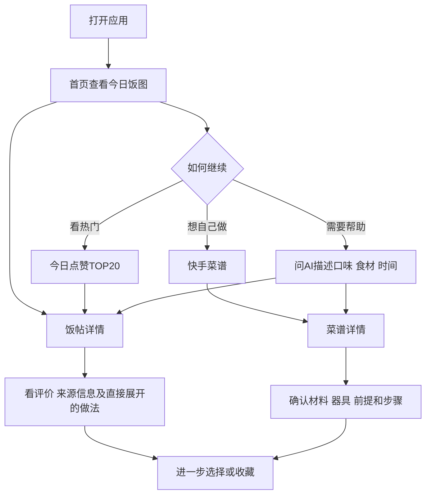
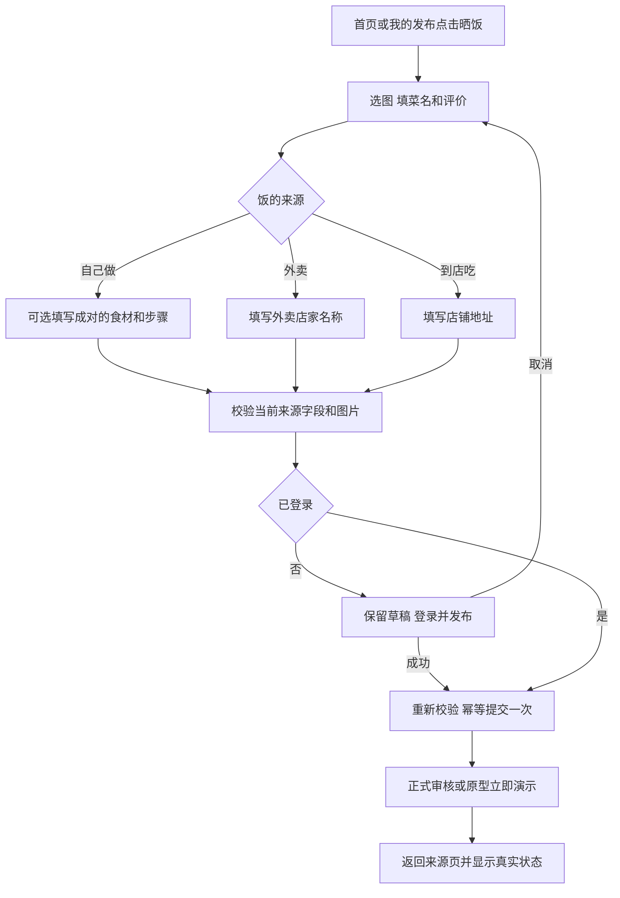
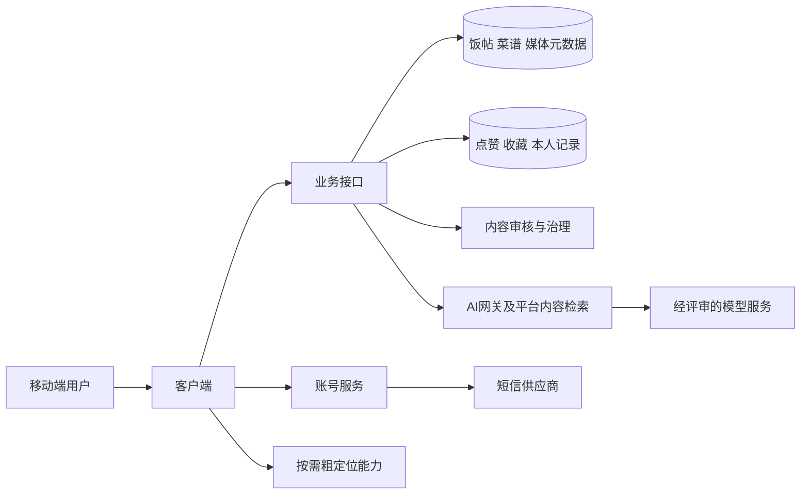
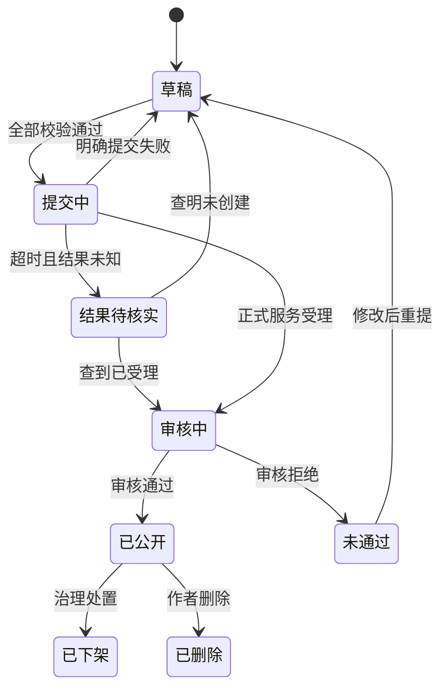
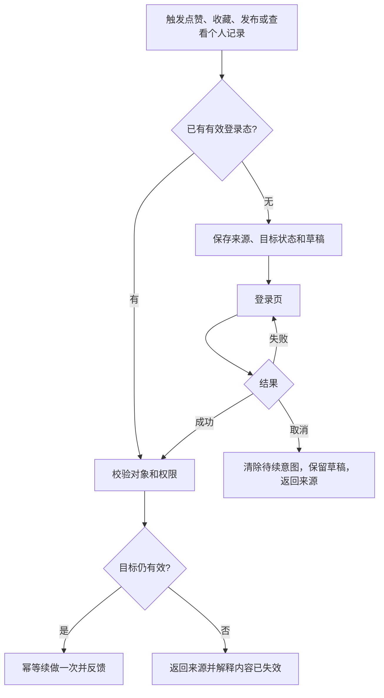
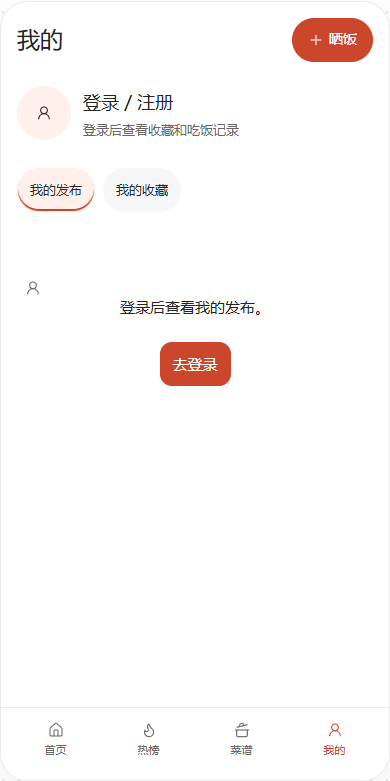
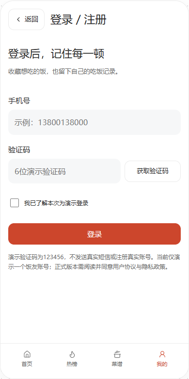
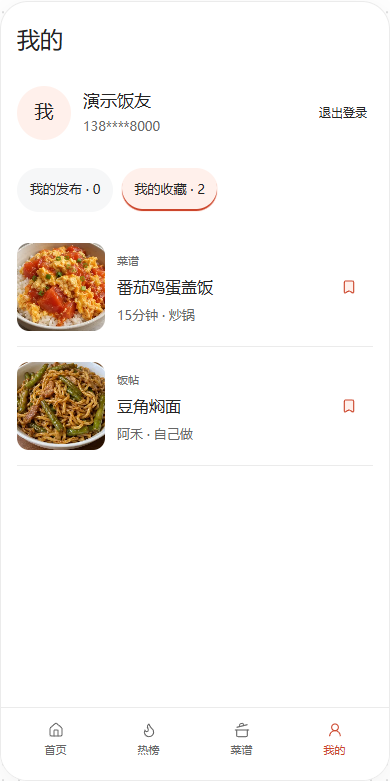

# MealMate 移动端产品需求文档

版本：V1.1.2 已实现同步版  
日期：2026-11-22  
产品名称：MealMate（对外显示名称；工程名、应用标识为 mealmate / com.mealmate.app，正式商标另行确认）。  
适用范围：移动端消费者 App（Flutter）与配套后端、管理后台；以当前番茄橙红 UI 为视觉和交互基线。

| 版本 | 日期 | 修订角色 | 修订内容 |
|---|---|---|---|
| V1.0.0 | 2026-10-30 | 产品与设计协作 | 汇总已讨论功能，补充登录、统一收藏小图、工程要求及验收口径 |
| V1.1.0 | 2026-11-20 | 产品与研发协作 | 把已落地实现同步进 PRD：产品更名 MealMate、PostgreSQL 与对象键存储、口味标签字典、人均价格、地图选点与店铺坐标、最近定位、草稿、发布结果提示、作者做法自由文本、搜索结果列表与默认不选中、页头去大标题、首页晒饭与筛选同排 |
| V1.1.1 | 2026-11-20 | 产品与研发协作 | 补齐最近定位写入时机：首页“附近”定位成功后写入、冷启动与回前台静默补写、24 小时/500 米节流；首页“附近”当前定位失败时先读最近定位再降级“全部” |
| V1.1.2 | 2026-11-22 | 产品与研发协作 | 删除饭帖举报与举报处理、账号注销、语音服务；会话令牌改为后端加密后下发；每日热榜由算法自动计算，取消运营复核；补齐 AI 三处入口与埋点；管理后台补齐菜谱管理、批量审核、用户详情查看发布、管理员与角色管理、数据看板、口味标签字典维护 |

本文件用于产品、设计、客户端、服务端、测试与运营共同评审首版范围。核心任务是帮助普通打工人在看到饭图后尽快决定想吃什么，或找到自己能简单做出的饭。截至 V1.1.2，Flutter App、FastAPI 后端、PostgreSQL 数据库、管理后台与真实定位/地图搜索已完成联调：登录、发布、草稿、点赞、收藏、热榜、菜谱、口味标签、地图选点等均已走后端接口；图片存本地对象目录但数据库只保存对象键，可平滑迁移到对象存储。AI 仍为示例或未接入；埋点上报与管理后台数据看板已落地。会话令牌由后端加密后返回，数据库只保存摘要。

需求状态统一分为五类：“已实现”表示代码、数据库与真实接口已完成并有验证记录；“已确认”表示已确定的产品方向和交互；“原型演示”表示当前 UI 可以验证的范围；“正式开发新增”表示真实产品必须补齐但尚无的服务与运营能力；“建议待确认”表示本文给出默认方案，评审后才能作为最终基线。未标为已确认的参数，不应被当作现成业务结论或供应商承诺。

## 一 概述

### 1.1 背景与产品定位

普通打工人的吃饭决策常同时受到时间、预算、食材、做饭器具和精力限制。现有处理方式包括反复浏览外卖列表、询问同事、重复点熟悉的餐食，以及在大量步骤复杂的菜谱里筛选。这里描述的是产品假设与使用场景，尚无访谈样本、市场规模或实际转化率可作为验证结论。

产品把“今天别人吃了什么”的真实图文作为发现入口，把“我能否简单做出来”的菜谱作为执行入口，AI 帮助缩小候选范围和解释已有内容。社区发布与收藏承接长期内容积累；浏览不强迫登录，发生个人写入时再建立账号会话。

**核心用户任务：打开应用后，尽快选出一份想吃的饭，或一份适合自己条件的简单菜谱。** 观看、点赞、收藏、打开菜谱都是意图信号，不等于实际购买、实际吃过或已经决定，数据分析不得混为一谈。热榜表示“今日晒饭中获得较多有效点赞的内容”，不能声称代表所有人的真实饮食偏好。

### 1.2 产品目标与验证方法

| 目标 | 指标与口径 | 默认建议与验证 |
|---|---|---|
| 减少选饭成本 | 从首次有效饭图曝光到主动选择进一步查看/收藏的时长；另做任务访谈确认是否真的作出选择 | 建议先邀请10名目标用户做可用性测试，至少7名在60秒内选出愿意尝试的一份饭或菜谱；作为立项验证目标，非已达到数据 |
| 知道自己能否做 | 用户能指出总耗时、器具和主要食材，理解已有熟米饭等前提 | 建议10人测试中至少9人能正确复述所选菜谱的关键限制；菜谱必须试做核验 |
| 保持内容可信 | 作者做法、平台参考与AI参考的归属可辨认 | 作者/平台/AI来源不能混淆；未知食材不凭图片补为事实；属于验收硬条件 |
| 支持社区积累 | 发布成功率、有效公开饭帖数、有效收藏及回访 | 内测先建立2周基线，再确定增长目标；不虚构已有留存、DAU或转化率 |
| 降低登录打断 | 登录完成率、取消后草稿保留率、原动作成功续办率 | 取消不得丢草稿；一个意图至多执行一次；按登录入口分组测量 |

### 1.3 目标用户与典型任务

| 用户群 | 使用情境 | 要解决的问题 | 典型路径 |
|---|---|---|---|
| 工作日外卖用户 | 午休或下班前 | 不知道想吃什么，想先看饭图和评价 | 首页/附近/热榜→饭帖→店家信息或收藏 |
| 下班做饭用户 | 时间少，有常见食材 | 找少步骤、少切配的家常饭 | 菜谱分类→食材/时间→做法 |
| 做饭条件有限用户 | 器具有限、厨房小 | 明确现有器具和时间能否完成 | 问AI输入限制→核实匹配菜谱→做法 |
| 日常记录用户 | 已经吃完或正在吃饭 | 留下饭图、感受与可分享做法 | 晒饭→选择来源→登录→发布→我的发布 |

### 1.4 名词与数据语义

| 名词 | 本文含义 |
|---|---|
| 饭帖 | 用户晒出的某一顿饭：图片、菜名、评价和来源；不等于完整菜谱 |
| 菜谱 | 一道菜的用料、用量、步骤、总耗时、器具与前置条件 |
| 一餐菜单 | 多道菜或主食/配菜的组合建议，由AI解释；不会直接等同于独立菜谱 |
| 来源 | 自己做 self、外卖 takeaway、到店吃 dine_in；后台使用稳定 code |
| 有效赞 | 经账号唯一性与风控处理后，仍有效的点赞关系；取消或无效赞不计入 |
| 今日 | [建议 E-06] 按 Asia/Shanghai 的自然日，以服务端权威时间为准 |
| 作者菜谱 | 作者明确随饭帖提供的完整用料与步骤 |
| 平台参考 | 明确关联或严格同名匹配的菜谱，不代表饭帖作者真实使用的做法 |
| AI参考 | 模型生成的建议，须有来源标识，不冒充实测菜谱或真实商家信息 |
| 收藏 | 当前账号对饭帖或菜谱建立的关系；类型和ID共同标识目标 |
| 口味标签 | 对一顿饭口味的可多选描述，取值来自服务端字典表 `taste_tags`（清淡、正常、香辣、酸甜、咸鲜、油炸、烧烤、汤羹、面食），客户端不写死 |
| 人均价格 | 作者填写的这一顿人均消费金额，整数，可空；只作参考，不代表商家报价 |
| 店铺坐标 | 外卖或到店时通过地图搜索选中的店铺经纬度与地点编号；手写店名时为空，不参与附近匹配 |
| 最近定位 | 用户最近一次成功获取并保存在服务端的经纬度，定位不可用时作为地图中心与附近匹配的兜底 |
| 草稿 | 已保存但未提交的饭帖，服务端有独立编号，可在“我的草稿”继续编辑或删除 |

### 1.5 角色与权限

| 角色 | 可访问内容 | 可执行操作 | 数据边界 |
|---|---|---|---|
| 游客 | 首页、热榜、菜谱及公开详情 | 浏览、切图、受配额约束的问AI、先填写发布草稿 | 不读取个人收藏和发布记录；点赞/收藏/最终发布先登录 |
| 已登录用户 | 公开内容与本人记录 | 点赞、收藏、发布、取消本人互动，查看本人状态 | 正式版以服务端accountId鉴权，不能用客户端传入的任意用户ID越权 |
| 内容编辑与审核运营 | 按岗位授权的内容工作台 | 维护试做菜谱与口味标签字典、审核饭帖、下架内容、查看数据看板 | 最小授权、记录审计；不是新增消费者一级Tab |
| 系统服务 | 业务必需的数据 | 账号验证、媒体处理、排序、内容检索、模型转发 | 密钥和权限校验置于可信服务端 |

### 1.6 阅读对象与评审责任

产品确认范围、目标与待确认项；设计确认视觉、交互状态和可读性；研发确认接口、权限、生命周期和容量；测试把需求编号映射到用例与证据；运营确认菜谱来源、试做、审核与反馈渠道。技术栈已确定为 Flutter + FastAPI + PostgreSQL + 腾讯位置服务；短信与 AI 供应商仍未定，不以此PRD替代接口联调文档、数据迁移方案或上线审批。

## 二 产品描述

### 2.1 首版范围及边界

首版范围为四个Tab，以及饭帖详情、菜谱详情、发布、登录与上下文AI。附近属于饭帖筛选，不承诺展示某个外卖平台的全部商家或全部可售餐品。首版不增加“发现”Tab、购物车、支付、配送、私信、关注流、评论系统、复杂搜索、独立营养计算器或后台定时通知。

最早提出的“随机附近的饭”和美团餐品接入保留为后续探索，不在当前已确认的四Tab和UI范围中。若重新纳入，必须单独确定候选来源、授权、营业/配送范围、去重与失败方案，不能把当前附近饭帖随机理解为可实时下单的外卖商品。

### 2.2 整体流程

#### 2.2.1 看图到选择

#### 2.2.2 发布和账号子流程

#### 2.2.3 正式系统数据流

客户端不直接携带模型、短信或第三方商家接口的生产密钥。数据流图仅表达职责，不锁定某种框架、数据库或云服务。

#### 2.2.4 发布状态

审核方案为 [建议 E-03]。原型使用立即写入内存的演示，不显示为真实审核成功；正式接口未知结果时不得不断新建同一帖子。

### 2.3 全局规则与视觉基线

| 项目 | 首版规则 |
|---|---|
| 一级导航 | 首页、热榜、菜谱、我的；二级页显式返回，保留来源与可恢复位置 |
| 主题 | 番茄橙红 #CC462C、白底、正文 #242424、辅助 #666666、浅灰 #F6F7F8、浅桃 #FFF0EB；深色模式使用对应可读配色 |
| 强调层级 | 主操作实色、分类轻底、Tab与点赞使用主题色；不让每个标签都成为主操作 |
| 尺寸 | 390逻辑像素为设计参考，支持320窄屏；左右16，窄屏12；卡片圆角12；正文14至16；主要可点区域至少约44×44 |
| 收藏 | 两种目标一律88×88方形小图横排，含类型、标题、摘要和取消收藏入口；与首页双列大图分开 |
| 图片 | 保持食物自然颜色；封面第一张；多图角落页码；图片不固定加统一暖色滤镜 |
| 列表加载 | [建议] 首页/菜谱/个人列表20条游标分页，触底加载和下拉刷新；热榜最多20条整体返回，无PC式分页器 |
| 排序 | 首页正式版建议首次公开时间倒序；我的发布创建时间倒序；收藏savedAt倒序；热榜见E-06 |
| 数据状态 | 首载骨架、已有缓存、追加加载、空结果、失败可重试、内容失效分别处理；不把接口失败显示成0条记录 |
| 返回及草稿 | 切换来源保留各自输入；取消登录保留草稿；退出账号清理个人缓存和本机草稿，正式版有未提交内容时先说明并允许取消 |
| 页头 | 四个主页面与二级页面不再显示大标题和说明性副标题；二级页面顶部只保留返回按钮和必要的右侧操作（如“我的发布”“我的草稿”的发布入口） |
| 主操作位置 | 首页“晒饭”与“全部/附近”筛选放在同一行右侧，三者高度一致（44）、圆角一致（22，胶囊形），用弹性布局贴边而不是写死坐标 |
| 发布结果反馈 | 发布成功后顶部浮层与返回上一页同时发生，提示停留约 1 秒后淡出；不额外进入详情页，也不等提示消失才返回 |
| 安全与文本 | 输入按纯文本呈现，不执行HTML和任意模型链接；错误给出可恢复方式，短提示不替代关键失败说明 |

公开列表可为空。冷启动不能用虚构用户身份、虚构点赞或AI图片冒充真实社区动态。运营示例应明确标识，正式平台菜谱采用合法来源并完成审核试做。

### 2.4 版本规划与开发依赖

| 阶段 | 范围 | 完成条件 | 时间 |
|---|---|---|---|
| UI评审 | 当前四Tab、登录模拟、统一收藏、来源表单、轮播与AI示例 | 视觉、流程和需求范围确认，记录未实现能力 | 当前交付；不等于可上线 |
| V1内测 | 真实账号、媒体投稿、菜谱、点赞收藏、榜单、AI文字、治理最小闭环 | 适用P0通过，真实服务联调、数据隔离与运营可用 | 团队与预算确认后排期 |
| V1完整目标 | 按需附近、完整异常恢复 | 位置授权、降级、配额与隐私方案通过；若延期需明确调整范围 | 技术依赖确认后排期 |
| 后续探索 | 随机选饭、经授权外卖数据、更多器具和食材策略 | 先验证用户价值与数据授权，再另行立项 | 无承诺日期 |

### 2.5 功能框架与优先级

| 模块 | 页面或能力 | 优先级 | 本版边界 |
|---|---|---|---|
| 首页 | 当天饭图、全部/附近、晒饭入口（与筛选同排） | 核心P0；附近已实现 | 附近只针对本平台有授权位置的内容；定位不可用时用最近定位兜底 |
| 热榜 | 每日有效点赞TOP20、四档角标、可靠食材标签 | P0 | 无菜谱榜；少于20不补足 |
| 菜谱 | 推荐、15分钟、一锅、少食材及详情 | P0 | 快手家常为主，时间与前提需核实 |
| 我的 | 登录态、我的发布、我的草稿、统一小图收藏、退出 | P0 | 无复杂社交资料、关注流或私信 |
| 发布 | 多图、菜名、评价、三来源分支、人均价格、口味标签、地图选点、作者可选菜谱 | P0 | 店名/地址可手写也可地图选点；手写不保存店铺坐标 |
| 问AI | 三处入口、上下文、文字条件选餐/菜谱与一餐搭配 | P0 | 只推荐可验证内容，生成内容明确来源 |
| 治理与账号安全 | 真实鉴权、审核、下架与删除 | 上线P0依赖 | 可复用既有管理服务，不为消费者增加Tab |

### 2.6 当前原型与正式实现的差异

当前 UI 可验证布局、真实账号登录、服务端收藏与点赞、服务端发布与草稿、图片上传、定位与地图选点、收藏小图、示例对话。截至 V1.1.2，除 AI 与短信供应商外，主要功能均请求真实后端并持久化。开发环境的短信验证码仍为固定演示码；AI 没有接入真实服务。首页、饭帖详情、菜谱列表三处均有 AI 入口；关键行为通过埋点接口上报。

正式版必须实现服务端账号鉴权、跨设备个人数据、实际图片处理和内容存储、有效赞规则、日榜、位置和模型能力，以及所有相关失败与治理路径。正式用例不能使用原型代替验收。具体功能规则见第三章，工程与接口见第四章，测试证据和通过条件见第五章。

## 三、功能需求（怎么做）

本章以已确认的四个移动端 Tab 和已迭代的 UI 稿为基线。标记为“已确认”的内容来自本次讨论；“建议待确认”是为使开发、测试可执行而提出的默认方案；“原型演示”只说明当前可点击稿的表现；“正式开发新增”必须在真实客户端、服务端及第三方能力中实现，不能据原型效果认定已完成。

### 3.1 导航、页面和全局操作

**描述与用户故事**：作为想尽快决定吃什么的用户，我希望打开应用就能看饭图，并随时进入热榜、简单菜谱或自己的记录，减少找入口的时间。

**前置条件**：应用可启动。公开浏览不以前置登录或授予定位权限为条件。**后置条件**：切换页面后有明确的当前位置；返回详情来源列表时保留筛选和浏览位置。

| 需求编号 | 元素/操作 | 默认与规则 | 反馈与边界 |
|---|---|---|---|
| REQ-NAV-01 | 底部主导航 | 固定顺序为“首页、热榜、菜谱、我的”，只设这四个一级 Tab | 图标和文字同时存在；当前 Tab 以主题色标识；重复点选不叠加路由 |
| REQ-NAV-02 | 二级页面 | 饭帖详情、菜谱详情、发布页、登录页为二级页面 | 有显式返回入口；从收藏或热榜进入详情，返回原来源，不一律回首页 |
| REQ-NAV-03 | 页面状态 | 每个 Tab 保留本次运行中的筛选状态与滚动位置 | 不把切换 Tab 当成重新初始化全部数据；主动下拉刷新可以更新数据 |
| REQ-NAV-04 | 公开与个人内容 | 游客可浏览首页、热榜、菜谱及详情，可使用问 AI；点赞、收藏和最终发布需要登录 | 点击受限操作后按 3.2 节登录并续做；不在应用启动时强制登录 |
| REQ-NAV-05 | 操作反馈 | 短成功提示不遮挡主要内容；错误贴近对应控件 | 网络失败不清空已输入内容；成功与失败使用具体对象，如“已收藏这份饭” |
| REQ-NAV-06 | 页头 | 首页、热榜、菜谱、我的均不显示大标题和说明文字 | 底部导航已标明当前位置，顶部不重复占高度；热榜直接以“今日点赞 TOP20”开始，菜谱直接以分类开始 |
| REQ-NAV-07 | 二级页页头 | 发布、登录、我的发布、我的草稿、我的收藏、饭帖详情、菜谱详情只显示返回按钮与必要操作 | 返回按钮承担导航；饭帖详情显示发布时间、菜谱详情显示试做数据，属于信息而不是宣传文案 |
| REQ-NAV-08 | 发布结果提示 | 提交成功后立即返回来源页 | 顶部浮层与返回同时发生，淡入 180 毫秒、停留约 900 毫秒、淡出 180 毫秒；不进入详情页，不等提示结束才返回 |

**业务流程**：启动进入首页 → 查看饭图或切换其他 Tab → 打开内容详情 → 返回来源列表；需要账号身份的操作进入登录子流程，完成后回到原上下文。

**异常与分支**：目标内容已删除或下架时，详情显示“内容暂时无法查看”，保留返回入口；导航加载失败保留底栏和已缓存内容；登录失效不能清空正在编辑的草稿；恢复到不存在的历史内容 ID 时回到对应 Tab，并给出轻提示。

| 字段 | 类型 | 必填 | 说明 | 示例 |
|---|---|---|---|---|
| page_key | Enum | 是 | 当前页面，使用稳定 code | `home`、`post_detail` |
| source_page | Enum | 条件必填 | 二级页面的来源页面 | `favorites` |
| target_type / target_id | Enum / String | 条件必填 | 详情或待续操作指向的对象 | `post` / `p_1001` |
| filter_state | Object | 否 | 当前分类等可恢复状态 | `{category: "quick"}` |
| scroll_anchor | String / Number | 否 | 优先用内容锚点，辅以像素偏移 | `p_1001` |

### 3.2 登录、退出和登录后续做

**范围与状态**：增加“我的”未登录/已登录两种界面。手机号验证码登录为 **[假设 A-01，建议待确认]**；首版建议不引入密码、第三方账号绑定、多账号切换或复杂个人资料表单。

正式版建议采用“验证码验证通过后，已有账号登录、未注册号码创建账号”的登录注册合一流程，列入 A-01 一并确认；不新增第二套注册表单，不在短信发送前公开提示该号码是否已注册。原型没有真实的号码归属验证或账号创建能力。

**用户故事**：作为游客，我希望先看内容，收藏或发布时再登录，登录后继续刚才的操作，不用重新找那道菜或重填晒饭内容。

**前置条件**：手机号格式、验证码获取状态及协议勾选等校验通过；真实版本需短信与账号服务可用。**后置条件**：登录成功建立有效账号会话，返回来源页面并最多续做一次原操作；取消或失败保持游客态。

#### 3.2.1 登录界面、校验与行为

| 需求编号 | 元素 | 类型/默认 | 校验与行为 | 失败/成功反馈 |
|---|---|---|---|---|
| REQ-AUTH-01 | “我的”登录区 | 头像占位、登录说明、登录按钮 | 游客状态不展示为“已登录”，不伪造已获取的个人资料 | “登录后查看发布和收藏”；个人数量可以隐藏或用未登录占位，不能把未请求数据等同于 0 |
| REQ-AUTH-02 | 手机号 | 数字输入，默认空 | 原型：11 位且以 1 开头；正式运营国家/地区范围待确认，前后端规则一致 | 格式错误时焦点定位输入框，提示“请输入正确的手机号” |
| REQ-AUTH-03 | 获取验证码 | 按钮，默认可点击 | 正式版在手机号格式、协议等前置校验通过后发起；原型仅模拟取码，勾选项在最终登录前校验；请求中不可重复点击；成功后 60 秒重发冷却 | 失败不开始成功倒计时，保留手机号并可重试；倒计时由服务端实际发送结果驱动 |
| REQ-AUTH-04 | 验证码 | 6 位数字，默认空 | 必须先获取验证码；输入满 6 位仍需点击登录，不自动提交 | 缺失、错误、过期分开提示；错误后不清手机号 |
| REQ-AUTH-05 | 协议与隐私说明 | 未默认勾选的复选框、可访问的文本入口 | 用户主动勾选后才发起相应账号操作；正式版协议链接须可阅读 | 原型只勾选“已了解本次为演示登录”，不提供正式协议；正式版本必须有可读的真实协议、版本及同意记录 |
| REQ-AUTH-06 | 登录主按钮 | 按钮 | 从“我的”进入显示“登录”；有待续操作时显示“登录并点赞/收藏/发布”等具体行为 | 校验通过后进入请求中状态；超时、错误不宣称成功 |
| REQ-AUTH-07 | 返回/取消 | 显式返回入口 | 关闭登录，清除该次待续操作；发布草稿保留 | 取消不会在之后从其他入口登录时误执行旧收藏或旧发布 |
| REQ-AUTH-08 | 登录成功 | 会话建立后执行 | 恢复来源页面、对象和筛选上下文；重新核验目标有效性与权限后只续做一次 | 有效对象完成原操作；已删除对象仅提示，不创建错误关系；不能重复加赞或重复发帖 |

正式短信挑战有效期、单号/设备/网络发送频率、错误尝试次数与封禁规则为 **[建议待确认]** 的服务端参数，不由客户端倒计时替代安全校验。验证码示例 `123456` 只能出现在原型或明确隔离的测试环境。

#### 3.2.2 登录后续做的约束

| 待续操作 | 登录前保留 | 登录成功后 | 取消/失败后 |
|---|---|---|---|
| 点赞或取消点赞 | 饭帖 ID、目标点赞状态、来源页面 | 按目标状态写入一次，再刷新计数和榜单 | 不修改计数，仍停留可浏览内容 |
| 收藏或取消收藏 | 对象类型、对象 ID、目标收藏状态 | 创建或取消一次关系，更新详情和“我的”列表 | 不产生收藏；来源内容仍可查看 |
| 最终发布 | 草稿全部字段、照片顺序、来源页面、提交意图 ID | 登录后重新校验草稿和上传状态，再进行一次提交 | 草稿仍在，未发生真实发布 |
| 查看个人记录 | “我的发布/我的收藏”子栏目 | 登录后进入对应栏目 | 返回未登录态，不显示其他人的个人数据 |

待续操作应保存目标状态和唯一操作标识，不能把网络重试写成反复切换的 `toggle`。用户取消登录时清除待续意图，草稿与待续意图分开保存。会话失效后重新认证同样遵守这些规则。

#### 3.2.3 原型与正式账号系统的边界

当前实现：手机号验证码登录由后端承担，开发环境验证码固定为 `123456`，会话与登录态保存在服务端并可跨重启恢复；登录接口校验手机号格式、验证码与协议勾选。短信供应商尚未接入，生产环境不得沿用固定演示码。登录成功后后端返回的是加密后的会话令牌：令牌由服务端生成明文随机串，使用对称加密算法加密后再返回给客户端，数据库只保存摘要；客户端不解析令牌内容，也不能伪造或拼接账号信息。管理后台使用同样机制，但使用独立的管理员会话表与更短的有效期。

退出登录时清空本地会话与待续意图，并使服务端会话失效；收藏、草稿与公开饭帖保存在服务端，重新登录同一账号可继续访问。不同手机号对应不同账号，服务端按账号做数据隔离。

正式版必须按 `account_id` 隔离收藏、本人发布、草稿与会话；退出清理本机个人缓存和凭据，服务端个人内容保留并在本人重新登录后获取。退出不等同于删除已发布内容。

| 字段 | 类型 | 必填 | 说明 | 示例 |
|---|---|---|---|---|
| account_id | String | 正式登录成功后是 | 服务端账号唯一标识；不使用手机号当公开 ID | `u_1001` |
| phone_number | String | 登录请求时是 | 原型仅内存；正式版只发送至必要的账号服务 | `<11位测试号码>` |
| verification_challenge_id | String | 正式验证码校验时是 | 关联一次发送挑战，不能只比较客户端常量 | `challenge_xxx` |
| verification_code | String(6) | 是 | 仅本次校验请求使用；不进入埋点 | `123456`（仅演示） |
| agreement_accepted | Boolean | 是 | 默认 false；正式版需关联协议版本 | `true` |
| resend_available_at | Timestamp | 发送成功后是 | 重发可用时间；原型冷却 60 秒 | `发送成功时间+60秒` |
| pending_action | Object | 有待续操作时是 | 类型、对象、目标状态、来源、唯一意图 ID | `{type: "save", targetType: "recipe"}` |
| session_state | Enum | 是 | `guest`、`authenticated`、`expired` | `guest` |

**异常分支**：发送失败可重试；验证码错误保留其他输入；正式版冷却期间重进页面保持剩余秒数；原型取消登录会清表单，重新打开须重新取演示码，不提供短信安全限流的证明；发送成功后修改手机号需重新取码，旧挑战不得用于新手机号；登录成功但待续操作失败只提示该动作失败，不能回滚为“登录失败”；登录成功回包晚于用户主动取消时，不再自动执行被取消的业务动作。

### 3.3 首页与附近饭图

**描述与用户故事**：作为打工人，我希望通过真实晒饭图片快速发现今天想吃的饭；有需要时可看看附近的人在吃什么。

**前置条件**：存在可公开展示的饭帖。附近模式另需可用的位置或用户选定区域。**后置条件**：用户可以进入饭帖详情、点赞或开始晒饭；拒绝定位仍能使用全部内容。

| 需求编号 | 元素/操作 | 已确认规则与建议默认 | 反馈/边界 |
|---|---|---|---|
| REQ-HOME-01 | 默认信息流 | 首页默认双列图片卡片，不以填写条件作为看图前置步骤 | 菜名、最多两行评价、作者、来源、点赞数清楚可见；图片保持原色 |
| REQ-HOME-02 | 卡片封面 | 取饭帖第一张图片；多图标出“n张” | 列表不自行轮播；真实原图比例不应拉伸，缩略图使用裁切 |
| REQ-HOME-03 | 全部/附近 | 默认“全部”；“附近”使用定位结果 | 定位顺序：手机当前定位 → 服务端保存的最近定位 → 都没有时弹框引导去系统设置；界面不提供位置开关，位置默认持续开启；拒绝不循环弹权限申请 |
| REQ-HOME-04 | 内容范围 | 首页主信息流为当天公开发布的有效饭帖 | “当天”统一按服务端业务时区计算；不把历史帖子伪装成今天 |
| REQ-HOME-05 | 排序与翻页 | 全部按首次公开发布时间倒序；同一时间按 ID 稳定排序，游标分页默认 20 条 | 翻页去重，不因插入新帖重复/漏掉已读项；顶部刷新获得新内容 |
| REQ-HOME-06 | 晒饭入口 | “晒饭”与“全部/附近”在同一行右侧，三个按钮同高（44）同圆角（22） | 游客可先填写草稿；最终提交时登录，不要求先回“我的” |
| REQ-HOME-07 | 跨日 | 正式版前台恢复或刷新时重新核对业务日期 | 首页与热榜切换到新的一天；旧饭帖仍可从历史记录和收藏查看 |

附近默认范围为 `NEAR_RADIUS_M=3000` 米，它是内容发现范围，不是商家配送范围。已实现规则：外卖/到店发布时自动附带公开的大概位置（后端降为三位小数），自己做不附带；客户端不提供位置开关，定位不可用时先读服务端保存的最近定位，仍没有才提示用户开启定位。正式版仅把允许公开位置的内容纳入附近计算，不公开发布者的精确坐标；外卖店名或到店地址不能替代发布者是否同意公开位置的判断。

**业务流程**：打开首页 → 默认看全部饭图 → 可点附近并完成位置选择 → 查看列表 → 打开饭帖 → 返回原筛选与浏览位置。

| 异常/分支 | 处理要求 |
|---|---|
| 今天暂无内容 | 显示“今天还没有人晒饭”，提供“晒饭”和“看看菜谱”；不把历史帖子伪装成今天 |
| 附近为空 | 说明“附近暂时没有今天的晒饭”，提供回到全部；不把全国内容仍标为附近 |
| 定位拒绝、系统关闭或超时 | 保留全部列表；可重试或手动选定区域的正式方案待确认 |
| 首页请求失败 | 有缓存则保留并标明未更新；无缓存提供重试，不出现无限转圈 |
| 图片失败 | 固定尺寸占位与重试，不造成瀑布流跳动；评价和标题仍可读 |
| 内容被下架 | 刷新后剔除；进入已缓存详情时以服务端可见性为准 |

| 字段 | 类型 | 必填 | 说明 | 示例 |
|---|---|---|---|---|
| post_id | String | 是 | 饭帖标识 | `p_1001` |
| cover_image | ImageRef | 是 | 第一张图的缩略图及原图引用 | `image_01` |
| image_count | Integer | 是 | 1—9 | `3` |
| title / review | String | 是 | 列表摘要与详情共用同一来源数据 | `豆角焖面` |
| meal_source | Enum | 是 | `self` / `takeaway` / `dine_in` | `self` |
| published_at | Timestamp | 已公开时是 | 服务端首次公开时间 | `2026-10-29T10:00:00+08:00` |
| public_location | ApproxLocation | 否 | 经允许公开的近似位置，缺失不进入附近 | `网格/区域引用` |
| liked_by_me / like_count | Boolean / Integer | 是 | 本人状态与公开总量分开 | `false` / `18` |

### 3.4 今日热榜与食材标签

**描述与用户故事**：作为还没有想法的用户，我希望快速比较今天点赞较多的饭，借助主要食材判断自己是否想吃。

**前置条件**：存在当天公开且至少 1 个有效赞的饭帖。**后置条件**：展示最多 20 条，进入的仍是饭帖详情，榜单数量和顺序可以追溯。

| 需求编号 | 元素/规则 | 具体要求 |
|---|---|---|
| REQ-RANK-01 | 榜单对象 | 只有当天饭帖点赞榜，没有另一份每日菜谱榜；前端不凑满 20 条 |
| REQ-RANK-02 | 排序 | 有效点赞数降序；**[建议待确认]** 同赞按首次公开时间升序，再按 ID 升序，避免刷新时随机跳位 |
| REQ-RANK-03 | 排名角标 | 放在缩略图左上角；第 1 名橙红底、第 2 名银灰底、第 3 名浅铜底；第 4—20 名统一中性深灰底；数字位置、大小与形状统一 |
| REQ-RANK-04 | 列表布局 | 左侧小图及角标，右侧菜名、食材标签、作者/来源和点赞；不再单独占一列显示排名 |
| REQ-RANK-05 | 主食材标签 | 最多 3 个，不作为可点击筛选 Tab；只显示明确记录的短食材名，油、盐等通用调料不占主要标签 |
| REQ-RANK-06 | 来源可信度 | 作者完整菜谱优先；平台明确关联或严格同名匹配时，标签旁显示“参考食材”；没有可靠来源就不补标签，不能看图猜成实际用料 |
| REQ-RANK-07 | 点赞同步 | 本人点赞状态与详情、首页一致；取消赞同步扣减；排名刷新采用服务端结果，不在客户端伪造热门度 |

**热度口径**：热榜展示“当天公开饭帖的当前有效累计点赞数”，不是下单量、真实食用量，也不宣称代表所有人的真实购买意图。正式版赞关系需去重、鉴权及防刷；非法/撤回的点赞不进入有效计数。原型用样例基础赞数加本人演示状态展示页面联动。

**更新建议**：点赞按钮立即反馈本人的预期状态，失败回滚并提示；榜单在本次刷新或可靠事件通知后重排，避免用户正在触摸时目标行突然换位。刷新间隔、缓存时效由性能章节确定，属于建议参数。

| 异常/分支 | 处理要求 |
|---|---|
| 无有效点赞内容 | 显示今日热榜空态，提供返回首页；不加入 0 赞饭帖凑榜 |
| 数据少于 20 条 | 如实展示条数，不放假内容或无意义占位排名 |
| 入榜内容删除/审核撤回 | 服务端查询排除，缓存失效后移除，余项递补并重新编号 |
| 赞数回包落后 | 以版本号/服务端结果协调，不能让较旧响应覆盖较新操作 |
| 食材长文本或缺失 | 超长未归一化内容留在详情，不把整段做法塞成标签；缺失保持行内自然留白 |

| 字段 | 类型 | 必填 | 说明 | 示例 |
|---|---|---|---|---|
| business_date | Date | 是 | 榜单业务日 | `2026-10-29` |
| rank | Integer | 是 | 1—20，按当前结果连续编号 | `1` |
| effective_like_count | Integer | 是 | 当前有效赞数，非负 | `18` |
| main_ingredients | String[] | 否 | 最多 3 个主要食材标签 | `["豆角", "面条"]` |
| ingredient_origin | Enum | 有标签时是 | `author` / `platform_reference` | `platform_reference` |
| snapshot_at / version | Timestamp / String | 建议有 | 用于缓存与一致性判断 | `rank_v12` |

### 3.5 饭帖详情、相册与内嵌菜谱

**用户故事**：作为对某份饭产生兴趣的用户，我希望看清不同照片和评价，并立即知道自己怎么做、去哪里买或去哪里吃。

**前置条件**：目标饭帖对当前用户可见。**后置条件**：图片、评价、来源及菜谱信息来源清楚；点赞/收藏与其他页面一致；返回保留上下文。

| 需求编号 | 区域 | 已确认行为 |
|---|---|---|
| REQ-DETAIL-01 | 内容层级 | 相册 → 菜名 → 作者/日期/来源 → 评价 → 点赞/收藏 → 店家/地址及做法；不要求再次点击“查看关联菜谱”才能看到做法 |
| REQ-DETAIL-02 | 三类来源 | 自己做展示作者菜谱或平台参考；外卖展示店家名称；到店吃展示店铺地址；店家/地址读取已发布数据，不借用当前草稿 |
| REQ-DETAIL-03 | 菜谱优先级 | 作者同时提供食材与步骤时直接展示作者做法；否则使用明确关联或严格同名的平台菜谱，标“来自平台菜谱·参考做法”；均无则说明尚无做法 |
| REQ-DETAIL-04 | 参考含义 | 平台做法不等同于照片作者实际用法，不将相似菜名或图像推测强行匹配；外卖/到店的可选平台参考也保留该标注 |
| REQ-DETAIL-05 | 图片 | 单张不显示页码；多张支持原生手指左右滑动；右上角显示 `1/3`；取消下方整行“上一张/下一张”按钮 |
| REQ-DETAIL-06 | 点选替代 | 轻点页码切换下一张并停止本次自动；有焦点时可用左右键切图；可访问名称说明当前张数与操作，不只依赖手势 |
| REQ-DETAIL-07 | 读图状态 | 同一饭帖点赞、收藏或开关 AI 引起界面更新时保留当前照片和手动停止状态 |

#### 3.5.1 自动轮播状态规则

| 状态/事件 | 处理 |
|---|---|
| 新进入多图详情 | 默认约 5 秒切换下一张，最后一张后回第一张；恢复已读照片索引后也重新等满 5 秒 |
| 自动程序引起滚动 | 仅同步照片索引和页码，不能误当成手动停止 |
| 用户明确横向滑动、鼠标横拖、横向触控板滚动或点页码/键盘切图 | 停止本次详情会话的自动播放；同次详情内点赞、收藏、关 AI 都不恢复 |
| 普通纵向阅读 | 不视为手动切图；图片可见区域不足一半时暂停，回到足够可见后重新等满 5 秒 |
| 打开 AI、应用转入后台 | 暂停；尚未被用户手动停止的会话在恢复后重新等满 5 秒 |
| 离开详情/替换相册 | 释放当前计时器和监听；重新进入是新的轮播会话，可以重新自动 |
| 单张/空图片异常 | 不创建轮播计时器；空图片异常使用固定占位并记录数据错误 |
| 系统开启减弱动态 | 不自动轮播；手动切图可用，避免强制运动效果 |

自动轮播计时不能造成多个控制器叠加；角落页码不会每次自动切换都强制屏幕阅读器反复播报。触摸轻点或纵向操作不应误判为横滑，鼠标移出图片松开也必须结束拖动状态。

**异常/分支**：详情请求失败可重试；部分图片失败保留其他图片和原顺序，不能悄悄改总张数造成页码错乱；菜谱数据缺失只影响做法区域，不使饭帖整页白屏；内容失效时隐藏点赞、收藏等不再有效的业务操作，并允许返回。

| 字段 | 类型 | 必填 | 说明 | 示例 |
|---|---|---|---|---|
| images | ImageRef[] | 是 | 按发布顺序，1—9 张 | `[image_01, image_02]` |
| author_recipe | RecipeBody / null | 否 | 作者实际填写的完整食材和步骤 | `{ingredients: [...], steps: [...]}` |
| platform_recipe_id | String / null | 否 | 明确关联的平台菜谱 | `r_101` |
| recipe_origin | Enum / null | 条件必填 | `author` / `platform_reference` | `author` |
| takeaway_store | String(80) / null | 外卖时是 | 实际发布的外卖店名 | `街角便当` |
| dine_in_address | String(160) / null | 到店时是 | 实际发布的店铺地址 | `演示路12号` |
| gallery_index | Integer | 运行时是 | 0 起始的当前照片位置 | `1` |
| gallery_manual_stop | Boolean | 运行时是 | 本次进入详情的手动停止状态，不作为永久用户偏好 | `true` |

### 3.6 快手菜谱列表与菜谱详情

**描述与用户故事**：作为做饭条件有限、下班时间紧的用户，我希望直接看到简单、好操作的菜谱，用少量分类和主要食材判断是否适合今天做。

**前置条件**：平台有经过整理并允许公开的菜谱。**后置条件**：用户明确所需食材、器具和总耗时，可以阅读做法、收藏，或交给 AI 按自己的条件进一步选。

| 需求编号 | 元素/操作 | 规则 |
|---|---|---|
| REQ-RECIPE-01 | 分类 | 默认“推荐”，并提供“15分钟开饭、一锅搞定、少食材”；均为单选，不要求先填食材、器具、时间三套筛选表单 |
| REQ-RECIPE-02 | 列表 | 小图图文横排；右侧依次菜名、总耗时/器具、主要食材标签；标签不作为另一组可点击 Tab |
| REQ-RECIPE-03 | 主要食材 | 最多 3 个，来自菜谱明示用料；完整材料、调料与用量在详情保留 |
| REQ-RECIPE-04 | “15分钟”口径 | 总耗时应包括必要洗切、加热和烹饪；若已有熟米饭、提前解冻等为前提，列表/详情需能发现这一条件；没有测试依据不标成保证时长 |
| REQ-RECIPE-05 | 详情 | 封面、名称、时间、器具、适用份数/前提、完整食材与步骤直接展示；收藏入口明确 |
| REQ-RECIPE-06 | 内容质量 | 正式菜谱补齐份量、主要火候、成熟判断、器具限制和可替代项，发布前试做；原型步骤与时间只是结构示例，不作为正式可交付菜谱库 |
| REQ-RECIPE-07 | 分类定义 | **[建议待确认]** “一锅”按核心烹饪器具数量定义；“少食材”建议主要食材不超过 3 种，常备调料另列，不用模糊宣传替代可验证标签 |

**业务流程**：进入菜谱默认推荐 → 可切一个轻分类 → 看图、时间和主食材 → 打开详情 → 收藏或开始照着做。AI 生成的一餐菜单是若干道菜的组合，不增加一个独立“菜单”一级 Tab。

**异常/分支**：筛选后没有结果显示当前分类空态，提供回推荐；菜谱下架不再推荐，旧收藏保留失效提示并可移除；图片缺失不影响食材步骤阅读；获取详情失败保留列表及分类；同一菜谱可同时拥有多个分类标签，列表展示时不重复。

| 字段 | 类型 | 必填 | 说明 | 示例 |
|---|---|---|---|---|
| recipe_id / title | String | 是 | 菜谱标识与名称 | `r_101` / `番茄鸡蛋盖饭` |
| total_minutes | Integer | 正式菜谱是 | 总耗时，附前提说明 | `15` |
| tool_codes | String[] | 是 | 对应的核心器具；正式版使用 code | `["wok"]` |
| category_codes | Enum[] | 是 | 推荐分类的可验证标签 | `["quick", "few"]` |
| servings | Number / null | 正式菜谱建议必填 | 默认份数与增减参考 | `1` |
| ingredients / steps | Object[] | 是 | 正式版含名称/用量和有序步骤；原型可为字符串数组 | `番茄、鸡蛋、米饭` |
| preparation_note | String / null | 有限制时是 | 熟米饭、解冻、器具等耗时前提 | `已有熟米饭` |
| content_source / tested_at | String / Timestamp | 正式内容是 | 来源与试做记录，供运营核验 | `平台编辑 / 试做日期` |

### 3.7 发布饭帖与三种来源表单

**描述与用户故事**：作为晒饭用户，我希望上传几张图片、写一句评价，再按自己做/外卖/到店吃补充对应信息，用尽量少的填写完成分享。

**前置条件**：公开浏览或“我的发布”中均能找到发布入口；可先以游客身份填写；提交成功前必须完成登录、文件校验、必要字段与内容可发布性校验。**后置条件**：生成一条饭帖，不重复；成功后清空已提交草稿，失败时保留内容。

#### 3.7.1 字段、显示与校验

| 需求编号/字段 | 控件/类型 | 必填 | 默认/长度 | 校验与反馈 |
|---|---|---|---|---|
| REQ-PUBLISH-01 / images | 多图选择与预览 | 是 | 1—9 张；单张不超过 5×1024×1024 字节 | 支持 JPG/JPEG、PNG、WebP、GIF；不能只检查扩展名；超限说明原因，原有照片和文字保留 |
| REQ-PUBLISH-02 / image_order | 预览顺序 | 是 | 按用户选择顺序；第一张为封面 | 可逐张移除；移除第一张后下一张成为封面；拖拽排序为后续增强建议，当前不能宣称已实现 |
| REQ-PUBLISH-03 / title | 文本输入 | 是 | trim 后 1—24 字符 | 纯空白不通过；不自动从图片编造菜名 |
| REQ-PUBLISH-04 / review | 多行文本 | 是 | trim 后 1—200 字符 | 鼓励味道、分量、这顿饭的感受；不会把用户输入当成 HTML 执行 |
| REQ-PUBLISH-05 / meal_source | 三段式单选 | 是 | 默认自己做 | 三种选项均可见：自己做、外卖、到店吃；切换就地更新字段 |
| REQ-PUBLISH-06 / recipe_ingredients | 自由文本输入 | 自己做时选填 | 最多 1000 字符，连续输入即可，不要求每行一项 | 输入框示例“例如：豆角 200 克、鲜面条 150 克、蒜 2 瓣”；提交时按换行拆分为列表；与步骤都不填可发布，只填一项时提示补齐或清空 |
| REQ-PUBLISH-07 / recipe_steps | 自由文本输入 | 自己做时选填 | 最多 2000 字符，可写一段话，不要求每行一个步骤 | 示例“例如：豆角掰段炒香，加水铺面焖 12 分钟，最后拌匀收汁”；仅校验当前来源；隐藏的半份菜谱不得阻止外卖或到店发布 |
| REQ-PUBLISH-08 / takeaway_store | 文本输入或地图选点 | 外卖时是 | trim 后 1—80 字符 | 点击“店家名称”进入全屏地图选点页，可搜索并选择店铺自动回填；也可手写。缺失聚焦该字段，提示“请填写外卖店家名称” |
| REQ-PUBLISH-09 / dine_in_address | 文本输入或地图选点 | 到店时是 | trim 后 1—160 字符 | 点击“店铺地址”进入地图选点页，选中店铺回填地址；也可手写。缺失聚焦该字段，提示“请填写店铺地址” |
| REQ-PUBLISH-10 / submit | 主按钮 | — | “发布这顿饭” | 读取照片、上传或提交中禁重复提交；游客先进入登录续做流程；成功后顶部浮层与返回同时发生，不进入详情页 |
| REQ-PUBLISH-11 / avg_price | 数字输入 | 否 | 整数，1—9999，可空 | 只允许数字；为空不提交该字段；非法输入就地提示，不清空其他字段 |
| REQ-PUBLISH-12 / taste_tags | 多选标签 | 否 | 取值来自服务端字典接口，可多选 | 字典加载失败显示重试入口，不阻塞草稿；旧草稿里已停用的标签仍可见并可取消 |
| REQ-PUBLISH-13 / store_map | 全屏地图选点页 | 外卖/到店时使用 | 地图铺满屏幕，顶部返回，右侧放大/缩小/回到当前位置，底部搜索框和“确认使用” | 搜索间隔 1 秒自动触发；结果以列表展示且默认不选中任何一条：点哪条才选中哪条，未点击则提交输入框里的名称；手写名称不保存店铺坐标 |
| REQ-PUBLISH-14 / place_search | 地点搜索 | 地图页内 | 关键词 → 最多 10 个相关地点（名称、地址、距离） | 结果按接口顺序展示；点击某条高亮并把地图中心移到该地点；地图服务不可用时提示可直接使用输入的名称 |

正式版应统一前后端字符计数方式和 trim 规则；以上限长为开发目标，原型原生输入控件只进行基础校验，不能替代服务端校验。用户输入不因来源切换而丢失，但提交只包含当前来源的业务字段，其他来源字段不混入饭帖。

#### 3.7.2 草稿和提交流程

1. 在首页“晒饭”或“我的发布”顶部/空态进入；不要求先跳回首页。
2. 图片先预览，保持选择顺序。游客草稿中的本地图片在正式方案中也不应未经身份校验直接上传到公开资源库。
3. 切换来源时分别保存三个分支的草稿值；公共菜名、评价、图片不重置。
4. 点击发布先做基础字段校验，再要求登录。登录取消保留草稿；登录成功后检查图片与内容当前状态，再执行一次上传和提交。
5. 正式版逐张显示上传/成功/失败状态；失败项支持重试或移除，已成功图片不重复上传；所有待提交图片就绪后才创建饭帖。用户没有明确移除失败图前，不静默发布一个缺图版本。
6. 正式版以服务端接收和可见性状态反馈结果：已公开才显示“发布成功”；进入审核则显示“已提交审核，审核通过后展示”，不假装首页已公开。
7. 从“我的发布”进入，完成后回该列表；从首页进入则回首页。返回与顶部结果浮层同时发生：浮层插入后立刻返回，在来源页继续显示，淡入 180 毫秒、停留约 900 毫秒、淡出 180 毫秒后自动移除；不进入详情页，也不等提示消失才返回。
8. 已实现服务端草稿：发布页可保存草稿；“我的草稿”可继续编辑或删除；草稿保存标题、评价、来源分支、图片对象键、人均价格、口味标签、作者做法与已选店铺坐标。提交成功后清空此次草稿，保留服务端饭帖标识；失败、超时及可恢复错误不清空内容。用户重试使用同一幂等键，避免网络超时后重复生成饭帖。
9. 外卖/到店提交时附带自动获取的大概位置（坐标降为三位小数）；作者通过地图选中的店铺坐标单独保存；手写店名或地址不带店铺坐标。

截至 V1.1.1，图片已真实上传并保存为“对象键 + 后端生成访问地址”的形式，数据库不依赖具体域名；发布、审核状态、草稿与幂等均已由后端接口承担，刷新后内容仍然存在。AI 仍未接入真实服务。

| 异常/分支 | 处理要求 |
|---|---|
| 图片类型/大小/总数不符合 | 明确哪类限制不符；保留原有已选图片、草稿；不通过部分写入制造未知顺序 |
| 图片读取或上传失败 | 标出失败项并可重试/移除；文字、顺序和其他成功图片保留 |
| 仅写了食材或仅写了步骤 | 自己做时展开菜谱区并聚焦缺失项；可补齐或清空；其他来源不校验隐藏菜谱 |
| 登录取消、失效或网络中断 | 保存本次草稿；未验证身份前不公开内容；重新登录后最多续做一次 |
| 提交超时但服务端可能成功 | 先按提交意图查询结果或幂等重试，不让用户重新无条件创建 |
| 发布审核未通过 | 本人可见原因及可采取动作；公开列表不展示；修改重提的具体范围作为正式发布前评审项 |
| 返回离开发布页 | 原型当前会话保留草稿；正式版建议本机私有草稿保存，换账号不自动共用，保存期限待确认 |

| 字段 | 类型 | 必填 | 说明 | 示例 |
|---|---|---|---|---|
| draft_id / submission_id | String | 正式提交是 | 草稿与一次提交意图独立 | `d_01` / `submit_01` |
| author_id | String | 公开提交是 | 由登录会话绑定，不能相信客户端传任意用户 ID | `u_1001` |
| meal_source | Enum | 是 | 稳定 code，展示文案另行映射 | `takeaway` |
| image_ids | String[] | 是 | 服务器已校验的图片引用，顺序即封面顺序 | `["image_01", "image_02"]` |
| title / review | String(24) / String(200) | 是 | 标题、评价 | `今天的盖饭` |
| author_recipe | Object / null | 否 | 仅自己做且两项完整时提交 | `{ingredients: [...], steps: [...]}` |
| takeaway_store / dine_in_address | String / null | 按来源必填 | 只提交当前分支 | `街角便当` / `null` |
| publication_status | Enum | 是 | 正式版区分待处理、已公开、未通过、已下架等 | `published` |

### 3.8 点赞、收藏与统一小图收藏列表

**用户故事**：作为用户，我希望给看起来想吃的饭点赞，并把饭帖或菜谱收进同一份清楚、尺寸一致的小图列表，以后快速找回。

**前置条件**：用户已登录，目标内容有效。游客触发操作时保留目标并进入登录。**后置条件**：本人状态与公开计数、详情和“我的”同步；收藏不重复、同一条取消后不残留。

| 需求编号 | 元素/规则 | 具体要求 |
|---|---|---|
| REQ-LIKE-01 | 点赞对象 | 给饭帖点赞，表达“看了想吃/喜欢”，不是已下单或已吃过；首版不增加菜谱点赞榜 |
| REQ-LIKE-02 | 唯一性与撤销 | 每个账号对每个饭帖最多一条有效赞；再次操作可取消；服务端防重复、校验有效内容 |
| REQ-LIKE-03 | 同步 | 首页、热榜、详情中的状态和数量一致；请求中不并行发送相反操作，处理失败回滚本人状态并给出重试 |
| REQ-SAVE-01 | 收藏对象 | 同时支持饭帖 `post` 和菜谱 `recipe`，唯一键包含类型，避免两者数字 ID 相同而串数据 |
| REQ-SAVE-02 | 统一样式 | “我的收藏”全部使用同一个横排小图组件，封面固定 88×88，菜名、摘要与操作在右侧；饭帖不复用首页大图卡，菜谱也不另用不同图片尺寸 |
| REQ-SAVE-03 | 类型与摘要 | 清楚标“饭帖/菜谱”；饭帖显示作者/来源等摘要，菜谱显示耗时/器具等摘要；标题至多两行，长内容不撑大封面 |
| REQ-SAVE-04 | 打开与取消 | 点击内容进入对应详情；提供独立“取消收藏”入口，不与整行打开事件冲突；取消只移除收藏关系，不删除原内容 |
| REQ-SAVE-05 | 排序 | 按收藏时间倒序；重复收藏不插入重复项，不无故改收藏时间；取消后重新收藏视为新收藏，排到前面 |
| REQ-SAVE-06 | 数量 | “我的收藏”数量反映当前账号有效收藏关系；原型只代表演示状态，不是跨设备云同步数量 |
| REQ-SAVE-07 | 失效内容 | 正式版原收藏对象删除/下架时显示小图占位和“内容暂时无法查看”，允许取消收藏；不能跳到另一个同名菜替代 |

**业务流程**：内容详情收藏 → 如未登录则认证并续做一次 → 收藏成功 → “我的—我的收藏”按时间倒序出现统一小图行 → 打开原对象或取消收藏。

当前实现的收藏关系保存在服务端并严格按账号隔离；游客个人视图隐藏收藏；切换账号后旧账号迟到的响应不得写入新账号界面。正式版必须从当前账号获取关系，不得沿用设备上另一个账号的列表。

| 异常/分支 | 处理要求 |
|---|---|
| 重复点击、重试或请求回包乱序 | 每个对象串行/合并目标状态，服务端唯一约束和版本校验；不重复增减数量 |
| 收藏内容在登录期间下架 | 登录仍成功，收藏不创建，回到来源并提示内容失效 |
| 取消收藏失败 | 列表恢复该行及原收藏时间，说明未取消成功；不能只移除 UI 而服务端仍保留 |
| 收藏为空 | 显示“看到想吃的饭、想做的菜谱，就收起来”，提供去首页/菜谱入口 |
| 收藏列表请求失败 | 保留上一次本人缓存或明确加载失败；不显示“你还没收藏”掩盖错误 |
| 封面失败或不同原图比例 | 始终占用同样 88×88 的布局；裁切不拉伸，不能恢复为大图卡 |

| 字段 | 类型 | 必填 | 说明 | 示例 |
|---|---|---|---|---|
| relation_id | String | 正式关系是 | 点赞/收藏关系标识 | `fav_1001` |
| account_id | String | 是 | 当前账号 | `u_1001` |
| target_type / target_id | Enum / String | 是 | 目标类型和标识 | `recipe` / `r_101` |
| target_state | Boolean | 写请求时是 | 明确期望为收藏/未收藏或赞/未赞 | `true` |
| collected_at | Timestamp | 收藏是 | 本次有效收藏创建时间 | `2026-10-29T18:00:00+08:00` |
| content_available | Boolean | 查询时是 | 收藏目标当前是否可见 | `false` |

### 3.9 我的发布、个人视图与退出

**描述与用户故事**：作为已登录用户，我希望从“我的”查看自己的晒饭和收藏，也能直接开始发布，不必回首页找入口。

**前置条件**：本人有效登录态；游客只显示登录引导和可进入的公开入口。**后置条件**：个人记录只属于当前账号，退出后不继续在个人界面暴露。

| 需求编号 | 元素/操作 | 规则 |
|---|---|---|
| REQ-MINE-01 | 个人区 | 未登录显示登录入口；已登录显示昵称/头像占位及账号状态；原型名称为“演示饭友”，不把输入手机号当成公开昵称 |
| REQ-MINE-02 | 我的发布 | 展示本人发布，**[建议待确认]** 正式版包含所有未删除历史记录，不因首页跨日而删除；公开、待审核、未通过等状态有明确区分 |
| REQ-MINE-03 | 我的收藏 | 使用 3.8 节统一小图列表；个人列表切换不改变数据归属 |
| REQ-MINE-04 | 直接发布 | “我的发布”“我的草稿”顶部和空态都有发布入口；非空时顶部入口仍存在；游客可先进入草稿，提交时登录 |
| REQ-MINE-05 | 草稿视图 | “我的”菜单拆出“我的草稿”独立入口，与“我的发布”分开 | 我的发布只展示已发布内容，不含草稿；我的草稿显示标题、来源与更新时间；点击继续编辑，可删除；发布成功后草稿自动消失 |
| REQ-MINE-06 | 退出登录 | 显式“退出登录”；回到游客视图，清除登录表单，不删除公开饭帖、服务端收藏或未提交的服务端草稿 |
| REQ-MINE-07 | 数据隔离 | 正式版切换账号后先清理旧个人列表，再获取新账号内容；请求回包必须核对账号，旧账号迟到响应不得填入新账号界面 |

**异常分支**：登录态失效时保留当前页面可恢复状态，个人内容停止继续请求并引导重新登录；本人记录请求失败不伪装成空记录；发布后列表请求暂未包含新项时可以显示已提交状态，不能反复创建；退出时若有未提交草稿，正式版建议先说明会清除并允许取消，原型点击退出后提示未发布草稿已清除；正式版按前述方案提供取消机会。

| 字段 | 类型 | 必填 | 说明 | 示例 |
|---|---|---|---|---|
| display_name | String | 已登录时是 | 原型固定演示昵称；正式用户资料规则待确认 | `演示饭友` |
| avatar_ref | ImageRef / null | 否 | 无头像时使用默认占位 | `null` |
| mine_filter | Enum | 是 | `posts` / `favorites` | `favorites` |
| my_post_count / favorite_count | Integer / null | 已登录且取得数据后是 | 未登录或未获取时不伪造个人数量 | `3` |
| my_post_status | Enum | 有本人饭帖时是 | 本人可见的提交/审核/公开状态 | `pending_review` |

### 3.10 问 AI：选餐、快手菜和一餐搭配

**描述与用户故事**：作为拿不定主意或做饭条件有限的用户，我希望用文字说明想吃什么、家里有什么、能用哪些器具和多久做好，让 AI 帮我缩小选择或组织一餐菜单。

**前置条件**：在首页、饭帖详情或菜谱列表中；首版允许游客使用，正式服务需配额与防滥用策略。**后置条件**：用户得到有来源和限制说明的候选菜谱/参考做法，能继续问或打开已存在的菜谱，不把 AI 输出误认成作者做法或平台已试做内容。

#### 3.10.1 入口、提示与聊天交互

| 需求编号 | 元素/操作 | 已确认规则 |
|---|---|---|
| REQ-AI-01 | 显示位置 | 只在首页、饭帖详情和菜谱列表显示；热榜、我的、登录、发布及独立菜谱详情不新增悬钮 |
| REQ-AI-02 | 小悬钮 | 约 48×48；小饭碗轮廓、星点和短轨道表达食物与智能感，保留“问 AI”文字；触摸区域不能随图形缩小至难以点按 |
| REQ-AI-03 | 拖动 | 可拖动并在松手后靠近左右边缘；限制在内容区，避开底栏和页头；拖动不误触打开聊天，键盘有位置调整替代 |
| REQ-AI-04 | 首页轻提示 | 首次未使用 AI 的首页前台停留约 10 秒后，仅展示一次“纠结吃什么？问我。”；约 4 秒收起，可主动关闭；用过 AI 后不再提示，不每 10 秒循环 |
| REQ-AI-05 | 提示取消条件 | 离开首页、打开聊天、输入、切后台或拖动时取消等待/收起提示；回到首页但已经展示过或已用 AI 时不重弹 |
| REQ-AI-06 | 聊天层 | 点击后在当前页面下部展开；消息气泡有可读底色，周围保留原页可见区域；不采用文字直接压在饭图上的全透明气泡 |
| REQ-AI-07 | 收起与恢复 | 显式收起，支持系统返回/键盘 Escape 的对应行为；同次运行保留聊天内容和当前参考对象，不重复添加开场 |
| REQ-AI-08 | 输入 | 文本默认空，trim 后 1—240 字符；空白不发送；输入法组合期间回车不得误提交；可以点发送或确认输入完成后发送 |
| REQ-AI-09 | 参考对象 | 面板显示“正在聊：…”；首次开场依所在页生成；进入其他页面后不偷偷覆盖已有对话，提供“聊当前页面”显式切换上下文 |

**开场内容方向**：首页介绍可根据口味、预算、食材和时间选饭；饭帖详情围绕当前菜的做法、替换食材和省事方法；菜谱列表围绕现有食材、器具、时间和一餐搭配。每次只用一句简短开场，不自动弹开聊天抢占看图流程。

“首页只提示一次”的正式存储范围为 **[建议待确认]**：建议设备安装级记录提示已展示，账号首次使用后也记为已使用；正常升级、退出重登不重复打扰。原型保留非敏感界面标记，但不等于真实账号偏好同步。

#### 3.10.2 推荐约束、来源与结果

| 需求编号 | 能力 | 正式开发目标 |
|---|---|---|
| REQ-AI-10 | 按要求选饭 | 提取用户明确表达的口味、预算、人数、时间与器具；已有条件不反复询问；缺少决定性信息时合并问一个关键问题 |
| REQ-AI-11 | 按现有食材选菜 | 区分家里已有、需要补买、可替代的材料；不能把需要大量缺失材料的菜直接称为“现有食材即可做” |
| REQ-AI-12 | 一餐菜单 | 给出少量候选或一餐组合，建议一次不超过 3 个主要候选；说明各菜的耗时、器具及合并烹饪前提，不简单把每道单菜时间相加或取最大值冒充总时间 |
| REQ-AI-13 | 硬性条件 | 用户明确不吃/过敏/不能使用的食材与器具是排除条件；无法核验时说清缺口，不给“保证可吃”等结论 |
| REQ-AI-14 | 结果来源 | 已有平台菜谱使用真实 recipe_id 卡片，可打开；作者实际做法仅引用作者明确提供的内容；生成内容标“AI 参考做法”，未试做不标为平台认证菜谱 |
| REQ-AI-15 | 做法与时间 | 不把饭图推断当作确定用料；不把炒锅做法直接改名成电饭煲做法；时间、份数、用量不足时标限制或追问 |
| REQ-AI-16 | 营养信息 | 可做一般食材与搭配介绍；缺少准确重量与依据时不编造精确热量、营养数值，不把普通推荐写成医疗建议 |

#### 3.10.3 异常处理

AI 回复和推荐当前仍是演示规则，不是真实模型推理、实时营养核算或可执行的外卖下单能力。真实 AI、检索、内容校验、服务配额和费用控制属于正式开发新增。

| 异常/分支 | 处理要求 |
|---|---|
| AI 请求失败、超时或配额不足 | 显示具体可恢复提示，保留用户问题和已有记录，可重试；不能放一段无关模板冒充推荐成功 |
| 生成中再次发送 | 正式版建议串行生成或让用户停止当前回答后继续，不能让两个回答插入错误上下文 |
| 用户切到其他饭帖 | 保持“正在聊”的明确对象；用户选择切换后再使用新对象，不将旧菜谱套到新饭帖 |
| 推荐的菜谱已下架 | 卡片显示不可用或移除可跳转入口，允许重新推荐；不使用失效 ID 跳错菜 |
| 不具备足够信息 | 说明缺少什么，提出少量补充问题或只给参考，不声称已满足全部限制 |
| 服务不可用 | 仍可使用首页、热榜与菜谱；AI 故障不得使主应用白屏或阻断浏览 |

| 字段 | 类型 | 必填 | 说明 | 示例 |
|---|---|---|---|---|
| conversation_id / message_id | String | 正式请求是 | 会话和消息标识，用于去重与串行 | `c_01` / `m_02` |
| context_type / context_id | Enum / String | 条件必填 | `home`、`post`、`recipe_list`；饭帖时带 ID | `post` / `p_1001` |
| text | String(240) | 是 | 用户确认发送的文字，非空 | `有番茄鸡蛋，15分钟做什么` |
| constraints | Object | 解析后建议有 | 口味、食材、器具、时间、人数、忌口等，保留明确/推测区分 | `{minutes: 15, tools: ["wok"]}` |
| answer_type | Enum | 是 | `recipe_candidates` / `meal_plan` / `reference_method` / `clarification` | `recipe_candidates` |
| recipe_refs | String[] | 有平台推荐时是 | 必须指向真实有效菜谱 | `["r_101"]` |
| content_origin | Enum | 是 | `author_quote` / `platform_recipe` / `ai_reference` | `ai_reference` |
| generation_state | Enum | 是 | `idle`、`generating`、`completed`、`failed`、`cancelled` | `completed` |

### 3.11 首版范围边界与正式开发补齐

首版确认范围不自动扩展成外卖交易平台或完整社交网络。评论、私信、关注、交易支付、订单读取、商家入驻、独立随机附近点餐、复杂营养追踪以及独立菜单 Tab 不作为本次已确认功能。若后续纳入，应另补需求、数据来源与验收，不把它们隐含在“社区”或“问 AI”里。

正式上线的社区仍需具备内容审核与下架、账号会话安全和个人数据处置能力；这些是正式开发补齐项，不代表已经有运营后台。最小运营角色、审核状态、处理时效与菜谱版权/授权来源需在上线前评审，客户端根据服务端可见性状态执行，不能仅靠前端隐藏。

外卖店名、到店地址目前由作者填写，不代表经过地图 POI 或外卖平台核验。美团接口、商家菜单、配送范围、库存价格及订单能力没有因本 PRD 自动获得授权；在官方接入范围、商务资格及实际可用接口核实前，正式客户端不能承诺“自动获取附近全部外卖”或“点击即可下单”。

## 四、开发标准与非功能需求

### 4.0 文档适用范围与实现状态

本章描述正式移动端产品的开发、测试与上线要求。当前已确定的技术栈：Flutter（Android/iOS 客户端）、FastAPI + SQLAlchemy（后端）、PostgreSQL（生产与本机开发数据库，SQLite 仅保留给自动化测试）、腾讯位置服务（地图与地点搜索，后端代理）、本地文件存储（对象键抽象，可迁移云存储）。短信供应商与 AI 模型尚未定案；以下接口为概念契约，可在技术评审后调整路径，但不得删减业务约束。

| 层次 | 本次交付可以确认的内容 | 不得据此认定完成的内容 |
|---|---|---|
| Flutter App（已实现） | 四个 Tab、来源表单、图文层级、相册交互、真实账号登录、服务端收藏点赞与发布草稿、定位与地图选点、统一收藏小图列表、三处 AI 入口、示例 AI 对话、关键行为埋点上报 | 短信供应商、真实 AI、完整审核与反作弊后台、后台数据看板之外的运营能力 |
| 正式开发 | 客户端、业务服务、账号、内容与媒体、互动、菜谱、AI 网关、运营治理之间的真实闭环 | 仅用本地模拟数据或页面状态代替业务服务 |
| 生产验收 | 真实集成环境中的权限、数据一致性、异常恢复、安全、性能、运营流程及可追溯证据 | 用演示码登录成功或原型点击通过代替生产验收 |

开发环境的手机号登录使用固定演示验证码，登录态与会话保存在服务端；正式环境必须切换为真实短信供应商。除 AI 与短信供应商外，其余模块均使用真实接口与数据库，本表只描述“已实现”与“未实现”的边界，不再代表只有内存演示。

### 4.1 安全、权限与内容可信度

#### 4.1.1 账号与登录安全

| 编号 | 正式开发要求 | 异常与验证要求 |
|---|---|---|
| DEV-AUTH-01 | 游客可浏览公开饭帖、热榜、菜谱和使用受限的问 AI；点赞、收藏、最终发布及读取个人记录必须登录。原型也演示该拦截关系。 | 游客直接请求受保护接口返回未认证错误；不得只依赖客户端隐藏按钮。 |
| DEV-AUTH-02 | 手机号验证码方案暂按 [假设 A-01] 执行；登录前展示可访问的用户协议和隐私说明，勾选项默认不选。 | 拒绝协议可返回继续浏览；不得因此清空发布草稿。正式协议文本与供应商确定后另行确认。 |
| DEV-AUTH-03 | 正式验证码由服务端生成、校验和作废；客户端不得包含生产万能码、短信密钥、验证码明文校验逻辑。 | 123456 仅在原型演示中有效；生产包、生产配置与线上接口不得接受该码作为固定通行码。 |
| DEV-AUTH-04 | 验证码与手机号、登录用途、挑战编号绑定，成功使用后失效；错误、过期、限流使用可区分业务码。 | 不能把 A 手机收到的挑战用于 B 手机；不能复用已成功使用的验证码。 |
| DEV-AUTH-05 | [建议 E-01] 60 秒内不可重复发送，验证码有效期 5 分钟，单挑战连续失败 5 次失效；服务端对手机号、设备与网络来源做限流。阈值可配置。 | 客户端修改时间或重装不能绕过服务端限制；服务端返回重试时间，客户端按其倒计时。具体日限额由短信供应商和风控评审确定。 |
| DEV-AUTH-06 | 正式账户使用不可变 accountId；手机号仅用于身份验证，不作为公开昵称、文章作者名或可猜测的用户主键。 | 未授权请求不得返回完整手机号、会话信息或其他用户的收藏、草稿。 |
| DEV-AUTH-07 | 客户端会话凭据存入平台安全存储；登录成功的响应只返回后端加密后的令牌，客户端不解析令牌内容，服务端只保存令牌摘要并校验有效期、撤销和账户状态，刷新请求做单飞合并。 | 会话失效后中断受保护写入，保留可恢复的当前草稿，登录成功后最多续办一次原动作。 |
| DEV-AUTH-08 | 登录跳转只携带结构化内部目标与一个待续办动作，不接受任意外部跳转地址。 | 取消、返回、重复点击登录成功按钮或重放登录结果，不得造成重复发布、重复收藏或重复点赞。 |
| DEV-AUTH-09 | 正式版退出时撤销本机凭据，立即隐藏个人记录并清理账户级缓存；切换账号时使用 accountId 隔离数据和草稿。 | A 退出后 B 登录不得看到 A 的个人数据；公共饭帖仍可按公开规则浏览。原型不作为这一点的验收环境。 |

#### 4.1.2 数据最少收集与存储

| 编号 | 要求 |
|---|---|
| DEV-SEC-01 | 所有正式网络传输使用 HTTPS；敏感配置仅在可信服务端保存。日志、埋点、报错与截图证据需要脱敏。 |
| DEV-SEC-02 | 手机号、凭据和验证码不得进入埋点；验证码不长期落库；手机号按访问用途控制读取和加密保存，检索采用不可直接还原的索引方案。具体密钥管理由安全评审确定。 |
| DEV-SEC-03 | “附近”按需申请位置授权；不申请通讯录、短信读取或后台持续定位。拒绝位置授权仍能看“全部”、热榜、菜谱与 AI。 |
| DEV-SEC-04 | 发布粗略位置单独征得用户允许；位置只用于附近匹配。公开内容不展示作者精确坐标、住宅位置或可推算实时轨迹的距离。用户主动填写的店铺地址与作者设备坐标分别保存。 |
| DEV-SEC-05 | 图片上传校验文件实际类型、大小、像素与资源归属；清除公开图片中的定位等非必要元信息；禁止仅按扩展名或客户端声明信任文件。 |
| DEV-SEC-06 | 正式版个人数据查询、修改、导出/删除需要有可执行入口或支持流程。数据保留与删除期限在上线前确定，不以“无限期保存”为默认值。 |
| DEV-SEC-07 | AI 网关仅发送本次问题、必要上下文和用户允许的偏好，不默认发送手机号、精确坐标、全部历史对话和私人草稿。 |

以下为工程规划默认建议，均为 [待确认 E-02]，不代表已完成合规审查：

| 数据 | 默认建议 | 删除与访问约束 |
|---|---|---|
| 正式发布草稿 | 本机按账号加密保存 7 天；用户可主动删除 | 退出或切换账号时清理本机草稿；恢复登录与清理提示的文案需可理解。原型只保留内存。 |
| 失败/放弃上传的媒体 | 24 小时内清理未绑定资源 | 不能删除仍被有效帖子使用的资产。 |
| 普通客户端诊断日志 | 30 天 | 禁止包含验证码、完整手机号与完整聊天内容。 |
| AI 本次聊天 | 默认本次会话；用户主动清除 | 若要跨设备历史，需要单独评审保存范围、期限和删除机制；V1 不默认引入。 |
| 已发布内容、点赞与收藏 | 用户保留期间按业务规则保存 | 撤回、删除、下架后按最终治理与法务方案清理/限制访问，不能只在页面隐藏。 |
| 安全与审核审计 | 建议 180 天，实际期限上线前确认 | 仅授权人员可访问；记录操作者、对象、原因、时间，避免复制原始敏感数据。 |

#### 4.1.3 内容与 AI 的可信度边界

1. 主要食材标签只能来自作者明确提供的食材或已关联的菜谱，最多展示 3 个；通用油、盐、水等不占主要食材标签。平台参考必须明确标记，缺失时留空，不从饭图补成事实。
2. 作者完整菜谱优先；平台仅在明确关联或严格同名匹配时提供参考。平台参考与作者实际做法不是同一事实，不得在列表、详情或 AI 回答中混淆。
3. 平台快手菜谱发布前需要编辑审核与实际试做；时间包含清洗、切配、烹饪，前置条件必须写出。“15 分钟”依赖已有熟米饭时必须明示，不把备料或煮饭时间隐去。
4. AI 生成做法必须标“AI 参考”，不能伪装成作者填写或平台试做过的内容；不得静默覆盖用户草稿或正式菜谱。
5. AI 营养说明以一般搭配解释为默认能力；没有具体用量与可靠计算依据时，不输出伪精确热量、营养数值或“保证健康”的结论。涉及忌口与食物过敏时，明确区分用户条件和已核实的食材，不以菜名或图片保证可食用。
6. AI 推荐优先返回平台已有 recipeId/postId；资源失效时给出可恢复说明，不能生成可点击但不存在的内容链接。外卖/到店的店家和地址只能来自已核实的数据，不由模型猜测。
7. 面向公开 UGC 正式上线前，需要审核、下架、删除和账号处置的最小运营能力。管理工具可采用既有系统，管理后台需覆盖饭帖审核、菜谱管理、口味标签字典维护、用户与发布查看、管理员与角色管理、审计日志和数据看板；不新增面向消费者的桌面端 App。
8. [建议 E-03] 正式饭帖状态采用草稿→审核中→已公开/未通过→删除或下架。只有已公开且当前可见的内容可进入首页、热榜和 AI 推荐。审核与申诉的实际处理时限由运营确认。

### 4.2 开发与质量标准

| 编号 | 标准 | 完成定义 |
|---|---|---|
| DEV-ENG-01 | 遵循实际落地项目的目录、代码风格、公共组件和 AGENTS 规则；先复用导航、按钮、输入、卡片、相册、登录、请求与异常处理组件。 | 公共组件个性化优先通过页面组合或配置完成，不能为单页外观改变无关页面行为。 |
| DEV-ENG-02 | 使用稳定业务枚举，例如 source=self/takeaway/dine_in、targetType=post/recipe；展示文案不作为接口匹配条件。 | 切换语言或修改“自己做”等文案后，分支校验与接口提交仍正确。 |
| DEV-ENG-03 | 登录拦截、待续办动作、账户隔离、列表小图行、作者/平台菜谱来源解析、图片播放控制各有单一实现入口。 | 首页、详情、热榜和“我的”不各自维护不同点赞/收藏事实；同一资源由统一数据源更新。 |
| DEV-ENG-04 | 新增函数写清作用与设计原因；复杂状态和计时生命周期需注释。删除废弃的按钮分支、重复计时器和不用的数据字段。 | 相册、AI 提示每个页面实例最多存在一个有效计时任务；组件销毁、切页、后台均有明确处理。 |
| DEV-ENG-05 | 界面文案集中管理；输入用纯文本展示与安全编码；不执行用户输入的 HTML、脚本、深链或模型输出的任意链接。 | 恶意菜名、评语、食材或 AI 文本不会触发脚本或破坏页面结构。 |
| DEV-ENG-06 | 所有写操作有忙碌态与防重复提交；服务端通过唯一约束/幂等键兜底。 | 快速连点与网络重试不能创建多份同一帖子或多条相同互动。 |
| DEV-ENG-07 | 请求有超时、取消和错误映射；切页后过期结果不得覆盖当前页面；列表刷新、加载更多与写操作各自管理状态。 | 慢请求返回不会把 B 页替换成 A 页内容，也不会把旧账户数据写入新账户缓存。 |
| DEV-ENG-08 | 发布校验按当前来源执行；隐藏字段不提交。输入在可恢复错误和登录取消后保留。 | 切换三种来源后互不误校验，服务端仍再次校验必填与长度。 |
| DEV-ENG-09 | 图片保存原始顺序与封面；列表请求合适尺寸缩略图，详情按需加载；单图不启动轮播。 | 收藏统一 88×88 逻辑像素方图行，饭帖和菜谱只有类型与摘要差别，不改变图片尺寸。 |
| DEV-ENG-10 | 相册保留原生触摸滑动和单指点按/键盘替代路径；自动切图与手动事件分开识别。 | 自动 scroll 不触发“手动停止”；纵向阅读不误判横向滑图；减弱动态时不自动轮播。 |
| DEV-ENG-11 | 可点目标原则上至少 44×44 逻辑像素，图形可小于触摸区；图标有可读名称，文字不用颜色作为唯一状态提示。 | 真机可单手点中 AI、页码、取消收藏、关闭提示；读屏可识别目标与当前状态。 |
| DEV-ENG-12 | 配置分开发/测试/生产；演示数据、固定验证码、模型模拟器和测试密钥有清晰环境边界。 | 生产构建检查会阻断模拟认证配置及调试敏感输出，构建产物不含生产服务密钥。 |
| DEV-ENG-13 | 自动化检查覆盖风险较高的认证、来源校验、幂等、排行榜、轮播生命周期、账户隔离与数据失效。 | 不把只镜像实现的测试或仅截图通过当成功能正确；视觉尺寸改动以浏览器/真机检查为主。 |
| DEV-ENG-14 | 每次交付包含变更范围、未实现项、环境、检查结果与回归影响。 | 原型验证与正式联调结果分别记录；失败项或未接入依赖不能标“验收通过”。 |

### 4.2.1 本项目代码与国际化约束

所有面向项目协作者的说明使用中文。修改前说明思路、范围和验证；优先复用公共组件，页面个性化通过组合或配置实现；修改限于已授权范围。可复用逻辑抽为公共函数，新增函数使用中文注释解释作用与原因，清理废弃代码。正式提交需要适用的静态检查、构建、风险用例和真机回归记录。

若正式代码沿用本项目 `src/lang/zh`、`src/lang/en` 的语言包结构，必须同步维护完全一致的key路径；顶层命名空间内使用camelCase，检索避免冲突；新增内容追加到对应模块末尾，不格式化无关历史内容。按本项目约定，英文包新增value只在中文前拼接EN，不自行翻译；不存在的模块需同步创建并在中英文index汇总。页面按钮、空态、错误、校验、Tab和提示均使用翻译调用，不新增中文key或`$t('中文文案')`。若选用其他移动框架，应在技术评审中明确对应的文案集中管理映射，不能误称当前尚不存在Vue工程。可运行时执行项目构建；不能运行时记录具体缺失环境，不把未执行写成通过。

### 4.3 性能、兼容与可观测性

以下为 [建议 E-04] 立项测试基线，待客户端与服务端技术评审确认；当前 UI 稿未进行这些生产指标的压测，不得写成已达到。

测试条件：建议至少覆盖 1 台 4GB 内存 Android 中端真机和 1 台 iPhone 11 同等级真机；每项不少于 30 次采样；网络基线为下行 20Mbps、上行 5Mbps、往返时延 80ms；另做 400ms 时延、2% 丢包和离线恢复测试。资源库至少 10,000 条可见饭帖、500 道菜谱、单人 1,000 条收藏。正式最低系统版本与上线平台 [待确认 E-05]，默认建议 Android 12+、iOS 16+，实际以用户覆盖与框架支持评审为准。

| 指标 | 建议目标 | 测量口径 |
|---|---|---|
| 冷启动可用首屏 | P95≤3 秒 | 启动至首页首批可点击饭图与导航出现；不以只有骨架屏计成功。 |
| 热启动/缓存返回 | P95≤1.5 秒 | 已有有效缓存时恢复可操作页面。 |
| 常规读取接口 | P95≤600ms | 网关接收至返回完整业务响应，排除图片下载和第三方 AI；客户端额外记录端到端耗时。 |
| 点赞/收藏写入 | P95≤800ms | 业务服务返回权威状态与计数；界面反馈不等于服务端成功。 |
| 首页加载更多 | P95≤1.5 秒 | 用户触发至下一批数据可用，保留当前滚动位置。 |
| 榜单更新 | 写入成功后≤10 秒可见 | 作为短时最终一致性建议；响应包含 generatedAt 和统计口径。 |
| AI 首次可见回复 | P95≤5 秒 | 服务端接收问题至出现有效回复片段；等待中有状态并可停止。 |
| AI 超时 | 建议 30 秒 | 到时明确失败，可编辑原问题重试，页面继续可用。 |
| 验证码识别超时 | 建议 15 秒 | 验证码提交至返回结果；超时可重试，保留已填写手机号与协议勾选。 |
| 相册自动间隔 | 前台可见条件下约5秒，容差±0.5秒 | 按相邻两次自动切换的开始时刻计；暂停恢复后重新等满间隔，系统调度、后台或手势占用不计失败。 |
| 首页 AI 首次提示 | 连续满足条件约10秒，容差±1秒 | 不在后台、输入或打开 AI 时累计；显示约4秒，用户可主动关闭。 |
| 列表滑动 | 无超过100ms的可感知主线程卡顿；目标接近设备刷新率 | 在既定数据量与真机条件下测量，不凭桌面浏览器截图推断。 |
| 崩溃与接口监测 | 上线前具备崩溃、超时、5xx与第三方失败告警 | 告警到业务模块/版本/请求编号，不附带原始隐私内容。可用性目标按预算另确认。 |

图片和相册需要在应用后台、页面离开或用户开启减弱动态时停止自动行为。减少动态设置不影响手动切图、页码、阅读和主要操作。系统大字号下标题、标签与按钮可以换行，不能盖住正文或固定底栏。

### 4.4 逻辑数据模型与一致性

#### 4.4.1 核心对象

以下是逻辑模型，不预设关系型或文档型数据库。字段类型为业务类型，具体存储长度、索引与分区由研发评审；所有正式实体 ID 不依赖客户端当前时间生成。

| 对象 | 主要字段 | 约束与索引建议 |
|---|---|---|
| User | accountId、phoneEncrypted、phoneLookupKey、nickname、avatarAssetId、status、createdAt | phoneLookupKey 唯一；公开读取不返回手机号。status 为 active/restricted/deleted。 |
| Session | sessionId、accountId、credentialDigest、expiresAt、revokedAt、deviceRef | 凭据由服务端加密后下发，数据库只保存摘要；明文凭据不可进入业务日志；按账户与有效期检索。 |
| VerificationChallenge | challengeId、phoneRef、purpose、codeDigest、expiresAt、failedAttempts、usedAt、retryAfter | 同挑战单次成功；验证码只存摘要及必要状态；有到期清理。 |
| MealPost | postId、authorId、title、review、source、imageAssetIds、authorRecipe、platformRecipeId、takeawayStore、dineInAddress、avgPrice、tasteTags、storeLocation（storeLat、storeLng、storePoiId）、coarseLocationRef、status、publishedAt、createdAt、updatedAt、deletedAt | title 1—24 字、review 1—200 字；图片 1—9 张且有序；来源字段互斥；首页/榜单索引按可见状态和发布时间；deletedAt 非空表示软删除，不再进入任何公开列表 |
| TasteTag | name、sortOrder、enabled、createdAt | name 为主键，由运营维护；客户端只读字典，不写死取值 |
| UserLocation | accountId、lat、lng、area、updatedAt | accountId 既是主键又外键引用 User；只保留每个账号最近一次成功定位，用于定位不可用时兜底 |
| PostDraft | draftId、authorId、title、review、source、imageAssetIds、authorRecipe、avgPrice、tasteTags、storeLocation、updatedAt | 仅作者本人可读写；发布成功后删除；不进入公开列表与审核队列 |
| Recipe | recipeId、title、ingredients、mainIngredients、steps、tools、totalMinutes、preconditions、tags、contentOrigin、validationStatus、status | 总耗时必须有前提说明；主要食材≤3；平台菜谱需来源与试做审核状态。 |
| MediaAsset | assetId、ownerId、mime、bytes、width、height、storageKey、thumbnailKeys、status、createdAt | 正式上传前校验；发布只能绑定本人授权的已处理资产；缩略图尺寸独立于原图。 |
| Like | accountId、postId、active、createdAt、updatedAt、riskStatus | accountId+postId 唯一；取消/重试不重复增减；风控失效记录不计有效赞。 |
| Favorite | accountId、targetType、targetId、savedAt | accountId+targetType+targetId 唯一；targetType 必须区分 post/recipe；按 savedAt 倒序。 |
| AIConversation | conversationId、accountOrGuestRef、contextType、contextId、messages、createdAt、expiresAt | 上下文显式；消息不进入公开内容；采用最少历史传递和可清理会话。 |
| ModerationRecord | recordId、targetType、targetId、decision、reasonCode、operatorId、occurredAt | 可追溯下架与恢复，不能修改原始审计记录冒充新决策。 |

正式接口时间统一采用带时区的时间戳（建议 ISO 8601 UTC），客户端按产品统计时区展示。饭帖“今天”与日榜建议按 Asia/Shanghai 自然日 [待确认 E-06]：00:00:00（含）至次日00:00:00（不含）。本地设备改时区或改时钟不能改变入榜资格。

#### 4.4.2 日榜、互动与收藏规则

1. 日榜候选仅为统计日内首次公开、当前仍公开且有效赞数大于0的饭帖，最多20条。跨日后昨日帖子不再进入今日榜，历史内容仍可按其可见规则在收藏与个人记录访问。
2. [建议 E-06] 排序为有效赞数降序、publishedAt升序、postId升序；点赞数相同不并列显示同一排名。前3名以实际排序位置应用不同角标，第4名起同一角标样式。
3. 每账号每饭帖最多1个有效赞；取消后减1，重新点赞最多恢复1个。服务端负责唯一性与风控，不能按客户端展示数直接覆盖总计数。
4. 榜单允许短时最终一致，建议最多10秒；点赞响应先返回该饭帖的权威计数，榜单下一次刷新使用同一统计口径。客户端不能自己生成额外候选凑够20名。
5. 收藏使用“期望状态=true/false”写入，不使用无法安全重试的“反转状态”接口；同一意图重复请求得到同一结果。
   同一目标写入在客户端串行或合并，响应携带服务端状态版本；旧响应不得覆盖更新的意图。多设备并发以服务端已提交的权威版本为准，切回页面或重连后刷新。失败回滚只作用于仍是当前版本的操作。
6. 同时收藏饭帖和菜谱时统一按 savedAt倒序；取消后重新收藏视作新的收藏时间。标签显示“饭帖”或“菜谱”，图片都是88×88方图，按 cover 裁剪，标题最多2行；长标题在详情完整展示。
7. 内容下架或删除后立即停止公开详情、榜单及AI引用。已有收藏可保留“内容暂不可用”占位和取消收藏入口；不得从本机旧缓存继续暴露已收回的图片或正文。

### 4.5 接口与外部服务契约

#### 4.5.1 通用接口约束

客户端只调用自有业务服务/受控网关，正式服务密钥不下发客户端。响应至少包含 requestId、业务code、可安全展示的message和data；分页响应另含nextCursor、hasMore，榜单响应另含statDate、timezone、generatedAt。列表默认每批20条；服务端限制最大批量，游标顺序需稳定并按ID去重。

| 概念接口 | 方向与鉴权 | 核心请求/响应 | 幂等与异常要求 |
|---|---|---|---|
| 请求登录验证码 | 客户端→账号服务；游客限流 | phone、purpose、agreementVersion → challengeId、expiresIn、retryAfter | 同一请求重试需防重复发短信；格式错误、限流、供应商失败分别返回业务码。 |
| 验证并登录 | 客户端→账号服务；挑战校验 | challengeId、code → accountId、加密后的会话令牌、必要资料 | 挑战成功后作废；并发提交最多完成一次；令牌由服务端加密，客户端不可解析；是否自动创建新账户按A-01方案执行并在协议中说明。 |
| 退出登录 | 客户端→账号服务；登录 | 当前会话 → 已撤销结果 | 重复退出仍成功；本机立即隐藏个人数据，服务端撤销失败需可补偿。 |
| 当前用户资料 | 客户端→账号服务；登录 | 当前凭据 → 公开资料与必要账号状态 | 不能传入任意accountId读取他人手机号或权限。 |
| 首页饭帖列表 | 客户端→内容服务；可游客 | filter=all/near、cursor、可选粗位置 → 可见饭帖列表 | 附近需要用户授权的位置；无位置返回可理解状态，不冒充真实附近。 |
| 口味标签字典 | 客户端→内容服务；可游客 | 无请求参数 → 已启用的标签名称与顺序 | 字典由服务端维护，客户端不写死；加载失败时发布页显示重试入口，不阻塞草稿。 |
| 保存最近定位 | 客户端→账号服务；登录 | lat、lng、可选area → 保存结果 | 每个账号只保留最近一次；发布/地图选点、首页“附近”成功、冷启动与回前台均可触发；按 24 小时或 500 米节流；失败不影响本次操作，不阻塞主流程。 |
| 读取最近定位 | 客户端→账号服务；登录 | 无参数 → lat、lng、updatedAt 或空 | 手机定位不可用时作为兜底；没有记录返回可理解状态。 |
| 地点搜索 | 客户端→内容服务；登录 | keyword、地图中心 → ≤10 个地点（名称、地址、坐标、距离） | 由后端代理地图供应商，客户端不持有服务密钥；供应商不可用时提示可直接使用输入名称。 |
| 饭帖详情 | 客户端→内容服务；可游客 | postId → 图片、评语、来源、作者/平台菜谱归属、当前互动状态 | 不存在、未公开、下架分支不能泄露正文；公开游客互动状态为未登录。 |
| 今日热榜 | 客户端→榜单服务；可游客 | statDate（服务端可覆盖）→≤20条候选与统计时间 | 使用统一时区和并列规则；快照过期可提示刷新，不回填历史假数据。 |
| 菜谱列表/详情 | 客户端→菜谱服务；可游客 | category、cursor或recipeId →可见菜谱 | 不存在/下架明确反馈；标签、时间前提与来源信息完整。 |
| 设置点赞状态 | 客户端→互动服务；登录 | postId、liked=true/false → 当前状态、权威计数 | 账户+饭帖唯一；重复请求、乱序响应按最后有效意图处理；风控限制返回可恢复说明。 |
| 设置收藏状态 | 客户端→互动服务；登录 | targetType、targetId、saved=true/false → 当前状态、savedAt | 同一目标唯一；客户端失败时回滚，不能默默显示成功。 |
| 我的发布/收藏 | 客户端→个人内容服务；登录 | cursor → 当前账户记录 | 从会话取accountId；不信任客户端传入“我是某用户”；跨账号缓存隔离。 |
| 申请/完成媒体上传 | 客户端→媒体服务；登录 | 文件类型/大小/校验摘要 → 临时授权、assetId、处理状态 | 上传授权限时、限定类型/大小/归属；失败可单张重试；未处理资产不能公开发布。 |
| 提交饭帖 | 客户端→内容服务；登录 | 幂等键、标题、评语、来源互斥字段、有序资产、人均价格、口味标签、可选作者菜谱、可选店铺坐标 → postId、状态 | 服务端再次校验；超时重试复用同一幂等键并查询结果；不能每次重试新建一帖。 |
| 保存/继续/删除草稿 | 客户端→内容服务；登录 | 草稿字段或 draftId → draftId、更新时间 | 仅作者本人可读写；发布成功后草稿删除；重复删除仍成功。 |
| 发起/停止AI回复 | 客户端→AI网关；游客限额/登录配额 | conversationId、context、条件、消息 → 可取消的回复和真实资源ID | 限流、超时、模型不可用有明确状态；停止后迟到片段不追加到新对话。 |

建议错误映射：未登录/会话过期→回到登录并保留当前意图；无权限→说明当前对象不可操作；内容不存在或下架→不可用态；限流→明确等待时间；校验失败→定位字段；超时→保留输入并支持重试；服务异常→通用说明+requestId。不得把堆栈、数据库信息或供应商密钥直接显示给用户。

#### 4.5.2 集成范围与降级

| 外部依赖 | 正式用途 | 当前状态与降级 |
|---|---|---|
| 短信服务 | 手机号登录挑战 | 已实现验证码申请与校验，开发环境使用固定演示码；正式供应商未接入，生产不得回退到固定演示码。 |
| 对象存储与图片处理 | 原图、列表缩略图、上传处理 | 已实现本地文件存储与“对象键 + 后端生成地址”的抽象层；数据库不保存访问域名，后续可替换为云对象存储，失败保留草稿并支持单张重试。 |
| 地图/定位服务 | 地图选点、地点搜索、附近粗位置 | 已接入腾讯位置服务（后端代理，客户端不持有密钥）与手机系统定位；未配置地图 Key 时搜索与静态地图降级，用户仍可手写店名或地址；定位不可用时读取服务端最近定位。 |
| AI模型与检索 | 结合条件推荐平台内容、参考做法、一般搭配说明 | 未接入真实模型；不可用时保留问题，可继续浏览现有菜谱，不使用伪造的实时推荐。 |
| 内容审核/运营治理 | 公开UGC和平台菜谱治理 | 管理后台已具备饭帖审核、菜谱管理、标签维护、用户查看、管理员与角色、审计日志和数据看板。 |
| 美团等外部平台 | 后续可能的店家、菜单或跳转能力 | 不作为MVP前提。未经核实的全量附近餐厅、菜品、订单访问不得写成已可用；后续需核实真实开放范围、权限与数据用途后另立需求。 |

### 4.6 统计事件与指标口径

埋点成功或失败不得阻塞浏览、登录与发布。客户端按批次异步上报到 `POST /api/v1/analytics/events`，单批最多 50 条，按 eventId 去重；登录态由后端从令牌解析，不从事件体接收账号。公有属性建议为eventId、occurredAt、appVersion、platform、pageName、sessionRef、匿名化accountRef（登录后）、requestId（请求类事件）；统计时区和去重规则由统一数据层执行。

| 事件名 | 触发时机 | 专有属性 | 用途/去重 |
|---|---|---|---|
| page_view | 页面实际展示完成 | pageName、entry、targetType、targetId | 同一次进入页面记录一次，组件重绘不记新PV。 |
| meal_impression | 饭帖卡片至少一半可见1秒 | postId、listType、position | 按会话+列表+对象去重，用于曝光分母。 |
| meal_open | 用户打开饭帖详情 | postId、entry、position | 衡量从看图到主动查看，不能当成已决定吃它。 |
| recipe_open | 打开菜谱详情 | recipeId、entry、category | 衡量做饭意图；区分AI推荐、列表和收藏入口。 |
| login_open | 被拦截或主动点击登录 | entry、pendingAction | 登录漏斗起点，不上报手机号。 |
| verification_requested | 服务端确认接受发送请求 | challengeRef、resultCode | 不把点击发送等同于短信发送成功。 |
| login_result | 登录完成/失败/取消 | outcome、errorCode、durationMs、pendingAction | 按登录尝试ID去重；不得上报码值、凭据。 |
| pending_action_resumed | 登录后恢复原操作 | actionType、targetType、targetId、result | 检查是否重复续办或丢失意图。 |
| like_result | 服务端返回点赞/取消结果 | postId、desiredState、resultCode | 以成功结果计互动，不按点击数累计有效赞。 |
| favorite_result | 服务端返回收藏/取消结果 | targetType、targetId、desiredState、resultCode | 饭帖和菜谱分开统计；去重取服务端确认。 |
| publish_start | 进入晒饭表单 | entry、draftRestored | 草稿恢复单独识别，不能算新增公开内容。 |
| publish_result | 服务端确认提交状态 | source、imageCount、hasAuthorRecipe、resultCode、durationMs | 区分审核中、已公开、失败；不采集评语、地址和图片原文。 |
| source_change | 用户切换发布来源 | fromSource、toSource | 检查表单分支使用，不上传隐藏字段内容。 |
| gallery_change | 图片完成切换 | postId、index、imageCount、trigger=auto/swipe/pager/keyboard | 用触发来源区分自动曝光和主动操作。 |
| gallery_auto_state | 自动播放状态实际变化 | reason=manual/ai/offscreen/background/reducedMotion/leave | 只在状态变化记录，禁止每一帧或每次scroll都上报。 |
| ai_hint_impression | 首页首次提示实际展示 | entry、delayMs | 同用户/安装提示周期最多一次；次数策略需与已确认UI行为一致。 |
| ai_hint_action | 点击提示、关闭或自动收起 | action=open/dismiss/timeout | 评估发现性，不将自动收起记作用户拒绝。 |
| ai_open | 用户主动打开AI | contextType、contextId、entry | 区分悬钮与提示语；不在页面打开时自动记AI使用。 |
| ai_message_result | 一次问题完成/停止/失败 | inputMode、contextType、constraintTypes、latencyMs、resultCode | 只采集条件类别，默认不采集用户原文与完整回复。 |
| ai_recommendation_open | 点击AI给出的真实内容卡片 | conversationRef、targetType、targetId | 关联推荐到查看，不能推断已购买或吃过。 |
| nearby_result | 用户切换附近后的结果 | permissionState、resultCode、countBucket | 不上报精确经纬度和具体家庭地址。 |
| client_error | 可恢复业务/页面异常 | module、errorCode、requestId、networkState | 错误文案需脱敏；禁止原始表单、手机号或凭据。 |

核心指标建议先建立基线，不虚构已有转化率或直接给无依据增长承诺：

| 指标 | 可执行口径 | 注意事项 |
|---|---|---|
| 有效看饭率 | 首页访问会话中至少打开1个饭帖的会话数/首页访问会话数 | 仅代表进一步查看。 |
| 做饭意图率 | 打开菜谱或收藏菜谱的去重会话数/菜谱相关访问会话数 | 区分饭帖和菜谱，不把自动轮播当主动意图。 |
| 决策效率代理指标 | 首页首次曝光到首次主动打开/收藏目标的中位数与P75 | 只能作为代理；是否实际决定吃什么需结合用户研究验证。 |
| 登录完成率 | 成功登录尝试数/发起登录尝试数 | 分主动、点赞拦截、收藏拦截、发布拦截入口。 |
| 发布完成率 | 成功提交至审核/公开的草稿数/进入发布表单的去重草稿数 | 审核通过率单列，不能把提交成功等同于公开。 |
| AI有效推荐查看率 | 有真实推荐卡片被打开的成功对话数/含推荐卡片的成功对话数 | 按对话去重；不统计不存在资源或失败回复。 |

## 五、验收标准与测试要点

### 5.1 验收分层与通过条件

验收优先级：P0为核心闭环、安全/数据正确性或上线阻断项；P1为主要体验与异常恢复；P2为次要体验。通过条件为全部适用P0通过、无未解决高影响问题；P1/P2遗留必须记录影响、临时处理和负责人，由产品、研发、测试共同确认。没有后端、真实短信、真实AI、审核与账户隔离的环境，只能签署原型UI验收，不能签署正式上线验收。

证据至少包含：需求/用例编号、构建版本、客户端与系统版本、测试环境、账号角色、前置数据、实际步骤、预期与实际结果、截图/录屏或脱敏请求证据、结论、问题单编号。计时行为需录屏或自动化时间断言；仅静态截图不能证明轮播停止或提示不重复。

### 5.2 功能与异常验收矩阵

下表的G、W、T分别表示前置条件（Given）、用户操作/事件（When）与预期结果（Then）。标注“正式”的用例必须在真实集成环境验证；“原型”只验证模拟行为，不能替代正式用例。

| 编号 | 优先级 | G / W / T 验收条件 |
|---|---|---|
| AC-001 | P0 | G：游客首次进入；W：切换四个底部Tab；T：顺序始终为首页、热榜、菜谱、我的，不出现额外一级栏目，当前选中状态正确。 |
| AC-002 | P0 | G：游客；W：打开公开饭帖、榜单、菜谱；T：可直接查看，不被强制登录遮断。 |
| AC-003 | P0 | G：游客浏览详情；W：点击点赞；T：进入登录并记录唯一待办，取消后不产生有效赞，成功后最多执行一次点赞。 |
| AC-004 | P0 | G：游客；W：点击收藏；T：进入登录，保留原对象类型/ID与返回路径；成功后收藏原目标一次，取消不改变其收藏状态。 |
| AC-005 | P0 | G：游客已填写发布草稿；W：最终点击发布；T：进入登录且草稿含图片顺序、来源和各分支输入均保留；登录取消返回后可继续编辑。 |
| AC-006 | P0 | G：合法登录挑战；W：提交未勾选协议或格式不合法的手机号/验证码；T：阻止提交、定位错误且不清空其他字段，不向生产服务发送非法校验请求。 |
| AC-007 | P0 | G：原型未获取演示码；W：直接填写123456登录；T：提示先获取验证码；取得后用合法11位1开头手机号、6位演示码和勾选项可完成模拟登录，不发送真实短信。 |
| AC-008 | P0 | G：正式挑战绑定手机号A；W：用该挑战登录手机号B或复用已用验证码；T：服务端拒绝，不能创建B的会话。 |
| AC-009 | P0 | G：验证码已过期/达到错误次数上限；W：继续验证；T：服务端拒绝并说明重新获取；不得回退到固定演示码。 |
| AC-010 | P1 | G：刚发出验证码；W：60秒内再次点击、重启客户端或修改本地时间；T：正式服务仍按服务端retryAfter限流，客户端提示剩余时间。 |
| AC-011 | P0 | G：验证码或登录接口超时；W：重试；T：不重复发短信、不重复注册/续办，输入与原待办保留。 |
| AC-012 | P0 | G：登录已成功且存在待办；W：重复触发登录回调、返回再进入；T：待办被消费至多一次，不重复发布或重复增赞。 |
| AC-013 | P0 | G：原型已登录；W：退出；T：清除本次手机号、验证码、登录态与当前草稿；个人记录变为登录提示；既有演示收藏和公开示例帖子不被删除，重新演示登录可查看。 |
| AC-014 | P0 | G：正式账号A有个人数据；W：退出并登录账号B；T：B不能看到A的收藏、草稿、私有记录和缓存，直接篡改accountId请求也无效。 |
| AC-015 | P0 | G：正式会话失效且用户正在提交；W：接口返回未认证；T：阻止本次写入，保留可恢复草稿和意图，重新登录后由幂等规则续办至多一次。 |
| AC-016 | P0 | G：一个账号先后收藏饭帖和菜谱；W：进入我的收藏；T：两种内容都使用88×88方图横向小图行，不出现大图双列卡；类型标识与目标正确。 |
| AC-017 | P1 | G：收藏包含长标题、缺图、不同图片比例；W：查看并放大系统字体；T：缩略图框尺寸一致、缺图有占位、标题可换行且不盖住取消收藏入口，详情可读完整标题。 |
| AC-018 | P0 | G：同账号快速连续收藏同目标或重试；W：服务返回；T：最多一条收藏记录，计数不重复，post与recipe相同数值ID不相互覆盖。 |
| AC-019 | P1 | G：存在多条收藏；W：取消一条，再重新收藏；T：原取消生效，重新收藏后按新savedAt排在前部；其他条目顺序稳定。 |
| AC-020 | P0 | G：取消收藏请求失败；W：网络恢复；T：失败有提示并回滚或明确待重试状态，不静默丢失记录；再取消可成功且不影响其他目标。 |
| AC-021 | P1 | G：没有收藏；W：打开收藏页；T：显示明确空态与可执行的浏览入口，不显示虚构计数或样例冒充私人记录。 |
| AC-022 | P0 | G：已收藏内容被下架/删除；W：打开收藏和详情；T：显示不可用态及取消收藏入口，旧缓存不继续展示被收回内容。 |
| AC-023 | P0 | G：首页有今日、昨日和未公开饭帖；W：请求首页；T：按已确认日期与公开规则返回，未公开内容不出现在公开列表。 |
| AC-024 | P1 | G：首页分页加载中；W：快速刷新、继续滑动或返回详情；T：不重复插入同一ID，不错乱排序，失败可原位重试，返回保留合理滚动位置。 |
| AC-025 | P0 | G：拒绝位置权限或定位失败；W：选择附近；T：明确说明无法获取附近，可回到全部；不阻断浏览、不伪造真实距离。 |
| AC-026 | P0 | G：正式用户同意粗位置；W：发布并查看附近；T：仅使用允许的粗位置参与匹配，公开饭帖和响应不泄露作者精确坐标。 |
| AC-027 | P0 | G：今日有效候选只有6条；W：打开热榜；T：只显示6条，不用旧帖、0赞帖或虚构内容补到20。 |
| AC-028 | P0 | G：有效候选超过20条；W：打开热榜；T：按有效赞降序及已确认并列规则返回前20，客户端与服务端对相同数据排序一致。 |
| AC-029 | P1 | G：有至少6名；W：查看角标；T：排名在图左上，1/2/3底色不同、数字清楚，4至末尾同样式，无单独占位的左侧排名列。 |
| AC-030 | P0 | G：同账号同帖；W：多设备并发点赞、取消、重试；T：最多1个有效赞，计数不为负；最终以权威状态一致，不按点击次数累计。 |
| AC-031 | P0 | G：一条点赞被识别为无效或帖子下架；W：榜单刷新；T：无效赞不计数，下架帖子移除，排名与角标依新位置更新。 |
| AC-032 | P1 | G：正式点赞接口成功；W：在定义的一致性窗口内刷新榜单；T：建议10秒内反映权威结果，不用本机计数覆盖其他人的赞。 |
| AC-033 | P0 | G：跨越Asia/Shanghai的自然日边界；W：保持页面并刷新；T：今日候选与statDate切换正确，昨日帖不进入新今日榜；修改设备时钟不能改变资格。 |
| AC-034 | P0 | G：作者有完整菜谱、平台也有匹配；W：打开详情或热榜食材；T：作者信息优先，未混成平台菜谱；无来源数据时不从图猜食材。 |
| AC-035 | P0 | G：只有明确平台关联或严格同名菜谱；W：查看详情/热榜；T：直接展示参考做法与主要食材，并标“平台参考/参考食材”，不表述为作者真实用料。 |
| AC-036 | P1 | G：菜谱含很多食材与油盐水；W：查看列表；T：主要食材最多3个，普通调料不挤占标签；时间、器具和食材不会遮住标题。 |
| AC-037 | P0 | G：平台无匹配、作者未附做法；W：打开详情；T：说明暂无做法，不自动关联相似名称、不编造做法。 |
| AC-038 | P0 | G：用户选择15分钟分类；W：查看菜谱；T：仅返回符合已验证总耗时口径的菜谱；依赖熟米饭等条件在详情明确，不能将超时菜伪归入。 |
| AC-039 | P1 | G：分类结果为空或接口失败；W：打开分类；T：空态说明条件与可返回推荐入口，失败可重试，不把网络错误当作没有菜谱。 |
| AC-040 | P0 | G：三图饭帖刚进入且前台可见；W：连续等待约5秒两次；T：依次切至第2、第3张，页码同步；自动scroll不被误判为手动停止。 |
| AC-041 | P1 | G：轮播位于末张且仍满足自动条件；W：再等待一次间隔；T：回第一张，不越界、不产生空白；图片下方不恢复旧上一张/下一张整行按钮。 |
| AC-042 | P0 | G：正在自动轮播；W：真机用手指横向滑动；T：原生滑动可切图，之后本次详情不再自动切换；连续等待超过两个间隔仍保持当前图。 |
| AC-043 | P0 | G：已手动停止；W：点赞、收藏或开关AI导致重绘；T：当前图与手动停止标记保留，不重新自动播放。 |
| AC-044 | P0 | G：未手动停止；W：打开AI并等待超过5秒，再收起；T：打开期间不切图，收起后重新等待完整间隔才恢复，不立刻跳图。 |
| AC-045 | P0 | G：未手动停止；W：向下读菜谱使图片不足一半可见，再滚回；T：离屏暂停、回到可见条件后重新计时；纵向手势不永久取消轮播。 |
| AC-046 | P1 | G：轮播可运行；W：切后台再回前台；T：后台不继续更新显示，回前台后按新间隔计时，不追赶后台漏掉的多张。 |
| AC-047 | P1 | G：用户不便滑动；W：点击角落页码或用键盘切图；T：可切换并停止本次自动；读屏能读出当前张数和操作含义。 |
| AC-048 | P0 | G：离开多图详情；W：打开另一饭帖、单图或其他Tab；T：旧定时器被清理，单图无页码与轮播；重新进入多图可建立新的播放会话。 |
| AC-049 | P1 | G：开启系统减弱动态；W：进入多图；T：不启动自动轮播，手动切图和阅读仍可用；鼠标轻按后移出图片再松开不会留下永久占用状态。 |
| AC-050 | P0 | G：用户切换自己做、外卖、到店吃；W：观察来源字段；T：依次只有菜谱、外卖店家名称、店铺地址，不同时展示不相关必填项。 |
| AC-051 | P0 | G：自己做且不填菜谱；W：填完其他必填并提交；T：允许提交；只填食材或只填步骤时提示成对补全，不清空已填内容。 |
| AC-052 | P0 | G：已在自己做填半份菜谱；W：切外卖填店名后提交；T：隐藏半份菜谱不阻断外卖，不随外卖请求提交；切回自己做仍能继续原输入。 |
| AC-053 | P0 | G：外卖/到店来源；W：店名/地址为空格、超长或缺失时提交；T：对应字段报错，服务端同样拒绝；不能由隐藏的其他来源字段补足。 |
| AC-054 | P0 | G：选择图片；W：多于9张、单张大于5MB、伪装扩展名、损坏文件；T：明确指出问题，保留合法已选图片及文字，不能绕过服务端类型校验。 |
| AC-055 | P1 | G：多图上传部分失败；W：单张重试或移除；T：其他成功图片不重传，顺序和封面稳定，全部完成前不能误报发布成功。 |
| AC-056 | P0 | G：提交发生超时；W：连续重试；T：复用幂等键并查询权威结果，最多创建一个饭帖，不把未知结果直接当失败再新建。 |
| AC-057 | P0 | G：从“我的发布”发饭；W：成功提交；T：返回我的发布并显示正确状态，已公开后首页可见；从首页发布按其来源路径返回，不被固定送去其他Tab。 |
| AC-058 | P0 | G：正式审核未通过或服务失败；W：查看个人记录；T：显示真实状态/原因和可恢复方向，草稿可继续编辑，不冒充已公开。 |
| AC-059 | P0 | G：在首页、饭帖详情、菜谱列表；W：查看问AI入口；T：仅这三处显示48左右的悬钮，热榜、我的、发布、独立菜谱详情不显示；图形有食物与智能识别点。 |
| AC-060 | P1 | G：AI悬钮可见；W：拖到边缘、旋转/改变可用宽度；T：保留足够点击区并被限制在内容范围，不盖底栏、不跑出屏幕；拖动结束不误打开聊天。 |
| AC-061 | P0 | G：首次未使用AI、首页前台连续停留；W：约10秒后；T：只提示一次“纠结吃什么？问我。”，约4秒收起，可关闭，不循环每10秒弹出。 |
| AC-062 | P0 | G：提示已展示/关闭，或已打开过AI；W：反复返回首页并等待；T：本提示周期不再出现；输入、离开首页、后台时不抢弹提示。 |
| AC-063 | P0 | G：先在饭帖A聊过；W：进入饭帖B再打开AI；T：明确显示当前对话对象及切换上下文入口，不静默用A的信息回答B。 |
| AC-064 | P0 | G：用户输入口味、已有食材、器具、时间、忌口；W：正式AI推荐；T：硬条件进入请求与过滤，无法满足时说明，不伪造符合条件的菜；具体用料不明时不保证可食用。 |
| AC-065 | P0 | G：AI生成参考做法或营养说明；W：查看回复；T：来源归属清晰，不伪装作者/平台试做；缺少份量时不输出伪精确营养数值。 |
| AC-066 | P0 | G：AI正在回复；W：停止、收起、切页或发新问题；T：迟到结果不污染新会话或错误上下文；已有文字与输入保留，超时能重试且不重复扣减同一请求配额。 |
| AC-067 | P0 | G：AI返回资源卡片后目标下架；W：点击；T：显示内容不可用并可返回，不继续使用旧链接或编造替代店家。 |
| AC-068 | P0 | G：游客达到AI限额或供应商不可用；W：继续发送；T：明确告知限制/失败，保留问题并允许继续看现有内容，不显示假的成功回复。 |
| AC-069 | P0 | G：菜名、评语、食材或模型回复含脚本/恶意链接；W：显示并点击相关区域；T：仅作为安全文本展示，不执行脚本、不跳转任意未受控地址。 |
| AC-070 | P0 | G：账号受限、对象无权访问或资源归属不符；W：直接调用发布/删除/个人列表接口；T：服务端拒绝，不依赖客户端当前界面判断权限。 |
| AC-071 | P0 | G：公开饭帖被运营下架；W：从列表、收藏、热榜、AI卡片和缓存打开；T：均遵守不可见规则，治理操作有审计记录和合法授权边界。 |
| AC-072 | P1 | G：断网、超时、5xx或切页后迟到响应；W：刷新/重试/返回；T：原有可读内容与输入不丢，错误类型清楚，旧响应不覆盖新页面或新账号。 |
| AC-073 | P1 | G：320逻辑像素窄屏、大字号、深色模式；W：浏览四Tab、登录、收藏、详情和发布；T：无横向溢出，关键文字可读，触摸区不重叠，图片与标签不挤掉操作。 |
| AC-074 | P0 | G：生产构建与日志样本；W：检查认证、配置和数据上报；T：无固定万能验证码、生产密钥、完整手机号/验证码/凭据进入客户端产物或分析日志。 |
| AC-075 | P1 | G：按定义触发页面曝光、点赞、收藏、登录、发布与AI；W：核对埋点与服务结果；T：事件去重、触发时机、对象类型正确，自动轮播与主动查看不混算。 |
| AC-076 | P1 | G：满足性能测试基线；W：采样并记录P95；T：达到已确认目标或列明差距，不能拿桌面原型截图宣称真机性能通过。 |
| AC-077 | P0 | G：已完成 Flutter App、真实后端与数据库，但短信与 AI 供应商尚未接入；W：申请生产上线验收；T：已完成模块按正式用例验收；未接入模块只能标注待开发，不得签署全量通过，也不得用开发演示码冒充生产登录。 |
| AC-078 | P0 | G：需发布新版本；W：检查交付材料；T：PRD、接口契约、测试证据、未实现项、依赖配置、回滚与问题清单可追溯，未解决的P0不被口头跳过。 |
| AC-079 | P1 | G：进入四个主页面、发布页、登录页、我的发布、我的草稿、我的收藏；W：查看页面顶部；T：不显示大标题和说明性副标题；二级页面只保留返回按钮和必要操作；详情页仅保留发布时间、试做数据这类信息。 |
| AC-080 | P0 | G：进入首页；W：查看第一行；T：“全部、附近、晒饭”在同一行，左侧两个筛选、右侧晒饭；三者高度均为44、圆角一致，窄屏不换行、不溢出。 |
| AC-081 | P0 | G：从首页或我的发布提交饭帖；W：接口成功后观察页面；T：结果浮层与返回上一页同时发生，不等提示消失才返回；浮层在来源页淡入180毫秒、停留约900毫秒、淡出180毫秒后移除；不进入详情页。 |
| AC-082 | P1 | G：自己做来源；W：在食材和步骤输入框中各输入一段连续文字并发布；T：允许不按行输入，提交时按换行拆分；只填一项时提示成对补全。 |
| AC-083 | P0 | G：地图页搜索连锁店；W：等待1秒自动搜索；T：展示多个相关地点；默认不选中任何一条、地图中心不动；点击某条后该条高亮、地图中心移到该地点。 |
| AC-084 | P0 | G：搜索结果已显示但都不正确；W：不点击任何一条，直接点“确认使用”；T：不提交任何候选，返回发布页回填输入框里的名称，不保存店铺坐标、详情页无地图导航入口。 |
| AC-085 | P1 | G：口味标签字典接口失败；W：打开发布页；T：显示重试入口，不阻塞草稿编辑；重试成功后标签正常展示；旧草稿里已停用的标签仍可取消。 |
| AC-086 | P0 | G：手机定位关闭或权限被拒；W：选择外卖/到店或打开“附近”；T：先读取服务端保存的最近定位；仍没有时弹框说明并引导去系统设置；界面不提供位置开关。 |
| AC-087 | P0 | G：已保存草稿；W：进入“我的草稿”继续编辑、删除或发布成功；T：继续编辑回填全部字段与图片顺序；删除后列表移除；发布成功后草稿消失、只生成一条饭帖。 |
| AC-088 | P1 | G：已登录且已授权；W：首页“附近”定位成功、冷启动或回前台、发布选择外卖/到店；T：静默保存最近定位，不弹额外提示；24 小时内且移动不超过 500 米时不重复保存；节流记录按账号隔离；游客不写入。 |
| AC-089 | P0 | G：用户或管理员登录成功；W：检查登录响应、客户端存储与服务端数据库；T：返回的会话令牌是后端加密后的不可读字符串，客户端无法解析出账号或会话编号；数据库只保存摘要，日志与埋点中不含令牌明文。 |

### 5.3 上线与回滚检查

1. 正式开关分开控制注册登录、投稿、AI和附近；外部供应商失败不拖垮只读浏览。关闭投稿或AI时，用户能理解原因且草稿/问题可保留。
2. 灰度范围与时长 [待确认 E-07]：默认建议先内部测试账号，再有限邀请用户；是否扩大由崩溃、关键错误、发布成功率、审核积压、短信/AI成本及安全问题共同决定，不预设没有依据的固定上线日期。
3. 数据结构采用可兼容迁移；回滚客户端不造成已经公开内容或收藏丢失。幂等、鉴权与内容可见性校验不能通过“临时关闭”来换取发布。
4. 出现数据越权、固定验证码进入生产、无法下架违规内容、重复扣费/异常发送短信、严重崩溃等情况时，立即停止相关写入或回滚并保留必要审计证据。

### 5.4 需求与验收追溯

| 功能范围 | 主要验收编号 | 验收环境 |
|---|---|---|
| 四Tab与公开浏览 | AC-001至002、023至026 | 已实现；位置能力按“系统定位→最近定位→提示开启”执行 |
| 登录及一次续办 | AC-003至015、089 | 已实现验证码登录、后端加密令牌与服务端会话；短信供应商待接入 |
| 统一小图收藏 | AC-016至022 | 已实现服务端收藏与列表；跨设备与失效显示待回归 |
| 热榜与食材可信度 | AC-027至037 | 已实现每日有效点赞TOP20与四档角标；榜单由算法每日自动计算，无运营复核 |
| 快手菜谱 | AC-036至039 | 已实现列表、分类与详情；菜谱与试做状态由管理后台维护，不设运营复核环节 |
| 相册轮播与手动切图 | AC-040至049 | 已实现真机图片选择、上传、横滑与轮播暂停 |
| 三来源发布 | AC-050至058 | 已实现真实上传、幂等、审核状态与草稿 |
| AI提示与上下文 | AC-059至068 | 首页、饭帖详情、菜谱列表三处入口与首次提示已完成；真实模型未接入 |
| 工程安全、兼容与交付 | AC-069至088 | Flutter 构建、后端测试与接口测试已完成；iOS 真机与上线评审待补 |

测试用例应附需求编号或所属功能，测试结果需要证据和构建版本。上述区间是索引，不表示不同模块之间没有交叉，也不意味着整段用例均已完成。

### 5.5 全篇待确认项与默认建议

本表供评审逐项拍板。未确认项不阻止本版文档和UI交付，但涉及真实账号、AI、公开内容和技术平台的决策应在对应开发与上线前明确。默认值都是方案建议，不是已有服务能力、已签合同或性能实测结果。

| 编号 | 等级 | 主题与默认建议 | 不确认的影响 | 责任角色 |
|---|---|---|---|---|
| A-01 | 必须确认 | 手机号验证码登录注册合一；游客浏览/受限AI，点赞收藏最终发布需登录；正式协议、覆盖地区和短信供应商一起确认 | 账号接口、短信费用、隐私文本及真实登录上线 | 产品、研发、安全 |
| E-03 | 必须确认 | 正式投稿先审核后公开；具备下架、删除、审计和账号处置流程，可复用现有治理工具 | 公开社区上线与内容治理验收 | 产品、运营、研发 |
| E-05 | 必须确认 | 仅移动端；暂以Android 12+、iOS 16+为评审起点，技术框架中立；根据目标设备再定最低版本与跨端/原生方案 | 工程选型、真机范围与研发估算 | 研发、测试、产品 |
| A-03 | 必须确认 | AI文字供应商、部署及数据使用约定；建议初始游客每日5次、账号每日20次问答；全部额度可配置，实际依预算和内测调整 | 真实AI联调、配额与费用控制；原型不实现真实计费 | 产品、研发、运营 |
| E-01 | 建议确认 | 60秒重发、5分钟有效、单挑战5次错误失效；服务端限流与供应商能力共同确定 | 验证码异常与风控验收 | 安全、研发 |
| E-02 | 建议确认 | 草稿7天、孤立媒体24小时、诊断30天、聊天默认会话内、审计暂建议180天；正式期限需业务与法务评审 | 数据清理、供应商数据处理与上线审查 | 产品、安全、法务、研发 |
| E-04 | 建议确认 | 采用4.3节设备、网络和数据量基线与P95目标；并发规模依用户预测和预算压测确定 | 性能与容量验收 | 研发、测试 |
| E-06 | 建议确认 | Asia/Shanghai自然日；候选为当日首次公开且仍可见、有有效赞的饭帖；赞降序、首次公开时间升序、ID升序；更新建议10秒内可见 | 日期边界、并列、反作弊与一致性验收 | 产品、研发、测试 |
| A-02 | 建议确认 | 附近默认3公里、按需粗定位；结果不展示作者精确坐标；默认使用发帖时允许公开的粗位置，非持续追踪 | 位置匹配、无结果和授权测试；半径不影响全部浏览 | 产品、研发、安全 |
| A-04 | 建议确认 | 首批准备约30道经过试做、可授权使用的简单菜谱；社区内容来自真实投稿或明确署名运营内容，允许空榜 | 冷启动、内容质量和推荐可用性 | 内容运营、产品 |
| A-05 | 建议确认 | 菜谱“一锅”按核心器具定义，“少食材”主要食材最多3种，常备调料另列；列表标签最多3个，缺失不补猜 | 分类标签、菜谱审核和推荐条件一致性 | 产品、菜谱编辑 |
| A-06 | 建议确认 | 首页/菜谱/个人列表默认每页20条游标加载；收藏按savedAt倒序；返回以内容锚点恢复 | 分页接口、加载更多和返回体验 | 客户端、服务端、测试 |
| A-07 | 可后续补充 | AI提示建议按设备安装记录已展示，账号记录已使用；升级、退出重登不反复提示 | 偏好存储与跨设备策略；不改变10秒一次/4秒收起规则 | 产品、客户端 |
| E-07 | 可后续补充 | 内部测试→有限邀请→依据质量与成本评估扩大，日期由团队产能与依赖决定 | 发布计划与观测窗口 | 产品、测试、运营 |
| A-08 | 可后续补充 | 正式名称已确定为 MealMate（工程名 mealmate、应用标识 com.mealmate.app）；随机选饭和外卖平台接入放后续探索，不纳入本版交付承诺 | 商标检索与注册、后续版本立项及授权核查 | 产品、商务 |

### 5.6 第三方接入核查与参考

美团官方技术服务合作中心公开介绍外卖通用解决方案，支持SDK、openH5和openAPI形式，并提供门店、菜品、订单等能力及接入授权说明。这证明存在可合作的开放能力，但公开介绍不等于已经取得本产品的调用权限，也不足以确认“按任意用户位置取附近全部可售餐品”的数据范围与使用授权。

因此，本版只承诺作者填写外卖店名/到店地址，以及本平台授权位置的附近饭帖。若后续接美团，商务和研发须先确认具体接口、适用合作身份、授权主体、可返回字段、限流费用、内容展示权、跳转方式与失败降级。不得用未经授权的抓取或共享密钥代替正式授权。本结论是基于公开能力介绍的范围判断，不是美团对本项目的接入批准。

参考页面，核查日期2026-10-29：

- [美团外卖业务及通用解决方案](https://developer.meituan.com/isv/waimai?location=foodManagement)
- [美团技术服务合作中心能力中心](https://developer.meituan.com/ability-center/list)

### 5.7 原型对照与本次变更

交互基线为随本PRD交付的番茄橙红移动UI稿。原型包含示例饭图和模拟对话，所有视觉图仅用于确认信息层级，不能当作正式菜谱、真实用户证言或已经接通服务的截图。

本次新增“我的”未登录入口、手机号演示登录与退出，以及点赞/收藏/最终发布的登录续做。饭帖收藏与菜谱收藏统一为88×88小图行，含类型、摘要和取消入口，按最近收藏在前排列。首页大图和我的发布卡片不受此收藏尺寸规则影响。

### 5.7.1 V1.1.0 实现同步（2026-11-20）

以下内容已从“原型演示/建议待确认”转为“已实现”，本文相应章节已同步更新：

1. **品牌与工程**：产品名统一为 MealMate；Flutter 包名 mealmate、Android `applicationId` 与 iOS Bundle Identifier 为 `com.mealmate.app`；本地存储键统一 `mealmate_` 前缀。
2. **数据与存储**：开发数据库切换为本机 PostgreSQL；新增数据库迁移文件；图片改为“数据库保存对象键、后端生成访问地址”，为迁移云存储做准备。
3. **发布能力**：新增人均价格、口味标签（服务端字典）、店铺坐标、软删除；作者做法改为自由文本输入；发布成功顶部浮层与返回同时发生，不进入详情页。
4. **定位与地图**：新增服务端最近定位表与接口；发布页位置默认持续开启、界面无开关；全屏地图选点页支持 1 秒防抖搜索、候选列表、默认不选中、未选择时提交手写名称；地图服务由后端代理腾讯位置服务。最近定位写入时机已扩展到首页“附近”定位成功、冷启动与回前台静默补写，并按 24 小时/500 米节流、按账号隔离本地节流记录；首页“附近”定位失败时先读最近定位再降级“全部”。
5. **草稿**：服务端草稿支持保存、继续编辑、删除，发布成功后自动清除。
6. **页面结构**：四个主页面与二级页面去掉大标题和说明性副标题；首页“晒饭”移到“全部/附近”同一行右侧，三者同高同圆角。
7. **管理后台**：手机号登录、角色权限（RBAC）、内容审核与治理、运营看板已完成基础闭环，见管理后台相关文档。

### 5.8 本次原型验证记录

验证日期：2026-10-30。环境为本地浏览器中的移动端尺寸预览，包括320px窄屏；以下结果只证明当前原型交互，不等同于正式App真机或上线验收。

| 验证范围 | 本次结果 |
|---|---|
| 我的游客状态、登录与退出 | 通过；未登录时不展示个人列表和伪造的0条计数 |
| 登录输入校验 | 通过；校验手机号、当前号码取码、演示验证码及了解演示勾选；取码后显示60秒禁用倒计时 |
| 登录续办 | 通过；收藏、点赞在成功后续办；取消登录不执行原操作 |
| 发布草稿与一次提交 | 通过；取消登录后保留菜名、评价、图片及来源字段；再次登录后只生成一条饭帖并返回我的发布 |
| 收藏一致性 | 通过；饭帖与菜谱共用88×88缩略图、按最近收藏在前排列，取消收藏有效 |
| 320px窄屏 | 通过；登录与收藏无横向溢出，收藏图片保持88×88 |
| 相册与登录衔接 | 通过；用户手动切图后，经登录拦截再取消返回，等待超过5秒未重新自动播放 |
| 演示信息边界 | 通过；手机号和验证码未写入宿主保存状态，刷新后回到游客 |

### 5.8.1 V1.1.0 实现验证记录（2026-11-20）

验证环境：Android 模拟器（1440×2560）+ 本机 FastAPI 后端 + 本机 PostgreSQL + 腾讯位置服务。以下为手工验收结果：

| 验证范围 | 结果 |
|---|---|
| 首页与四 Tab 导航 | 通过；首页首行为“全部/附近/晒饭”，三个按钮同高；四个页面顶部无大标题 |
| 发布表单 | 通过；三来源切换、人均价格、口味标签（接口下发）、作者做法自由文本、图片 1—9 张均可提交 |
| 发布结果反馈 | 通过；点击发布后立即返回上一页，顶部浮层同时出现，约 1.2 秒后淡出，首页数据刷新 |
| 地图选点 | 通过；搜索 KFC 返回 10 个候选，默认不选中；点击某条高亮并移动地图中心；不点击直接确认则回填输入框名称且不保存店铺坐标 |
| 定位兜底 | 已实现；按“手机定位 → 服务端最近定位 → 提示开启”顺序执行；写入时机覆盖首页附近成功、发布/地图选点、冷启动与回前台（24 小时/500 米节流），关闭定位场景待回归 |
| 草稿 | 已实现；服务端草稿可保存、继续编辑、删除，发布成功后清除，待回归 |
| 鉴权与越权 | 后端测试覆盖未登录写入与越权访问拒绝 |
| 后端接口测试 | 工程基础迭代记录：20 条后端测试与 15 条接口测试全部通过（详见测试文档） |

### 5.8.2 V1.1.2 实现同步（2026-11-22）

本轮按评审结论完成以下调整，本文对应章节已同步：

1. **范围裁剪**：删除饭帖举报与举报处理、账号注销、语音服务；每日热榜由算法按 Asia/Shanghai 自然日自动计算，不设运营复核环节。
2. **会话令牌**：用户与管理员登录均改为“服务端生成随机串 → 对称加密 → 返回密文”，数据库只保存摘要；客户端不解析令牌。
3. **AI 入口**：首页、饭帖详情、菜谱列表三处均有 AI 悬钮；首页首次前台停留约 10 秒显示一次“纠结吃什么？问我。”提示，约 4 秒收起，可关闭，按安装记录只提示一次。
4. **埋点**：新增 `POST /api/v1/analytics/events` 批量上报接口（单批最多 50 条、按 eventId 去重、登录态由令牌解析），Flutter 按 4.6 节事件表上报页面曝光、饭帖曝光与打开、登录、点赞、收藏、发布、AI、附近与客户端异常等关键事件。
5. **管理后台**：新增数据看板、菜谱管理、口味标签字典维护、管理员与角色管理；饭帖审核支持批量通过/拒绝；用户详情可查看该用户发布；保留审计日志。

验证方式：后端执行 `pytest`，管理后台执行 `npm run build`；手工回归覆盖三处 AI 入口、埋点入库、批量审核、菜谱与标签维护、用户发布查看、管理员角色分配和数据看板。具体结果同步维护在测试用例文档。

仍未完成：真实短信供应商、AI 接入、生产环境压力测试、iOS 真机验证。第三章与第五章中标注“正式”的用例需在真实集成环境继续验证，不能把本PRD当作生产上线完成报告。

